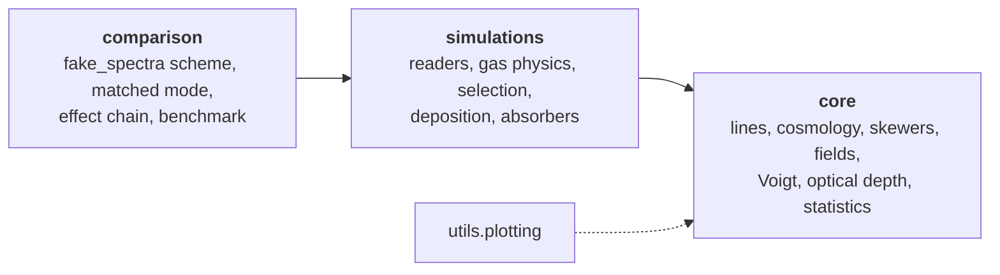
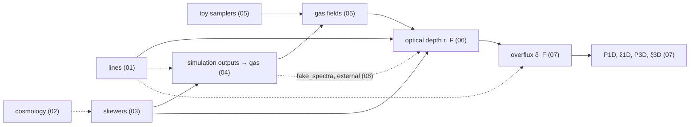

# SkewerJAX

SkewerJAX computes the optical depth τ(v) and the transmitted flux F = e^{−τ} of the Lyman-α forest and of metal
lines (Si III λ1206 and any other transition in its line table) along arbitrary skewers, together with their summary
statistics: the overflux decomposition by line, P1D, ξ1D, P3D and ξ3D. It is written in JAX, so the whole chain can
be compiled, vectorised and differentiated, and it runs on CPUs and GPUs. Gas fields come either from analytic or
Gaussian-random toy samplers, or from hydrodynamical snapshots (Arepo/IllustrisTNG HDF5). A dedicated subpackage
reproduces the scheme of fake_spectra, so that the two codes can be compared option by option.

**Key features**

- **Exact light-cone geometry.** a(x) is integrated along each skewer (diffrax), every line is integrated in its own
  line-centred frame, and the detuning is exact. Voigt profiles come from ExoJAX, with an FFT convolution and SciPy's
  Faddeeva function as alternatives.
- **JAX-first containers and kernels.** Every container (`LineBundle`, `Cosmology`, `SkewerBundle`, `Fields`,
  `LoSSamples`, `GasCells`) is a pytree, and `jit`, `vmap` and `grad` work throughout.
- **Memory-bounded kernels.** `lax.map` over skewers, a velocity chunk per call, and optional batching.
- **Optional speed-ups.** Sharding of the skewer axis over several devices (`optical_depth_sharded`), and an opt-in
  float32 τ kernel (`dtype="float32"`).
- **Simulation extraction.** Streamed snapshot I/O, k-d tree cell selection, and an exact Voronoi deposition of the
  cells along each skewer. Gas physics: TNG's stored neutral fractions, Rahmati et al. self-shielding for
  star-forming gas, and CLOUDY tables for metal ions.
- **Comparison with fake_spectra.** A matched mode reproduces fake_spectra to |ΔF| ~ 1e-5. An effect chain switches
  every difference on one at a time, and a benchmark harness measures both codes on identical skewers.

## Architecture



Dependencies run one way only. `core` imports nothing from the other subpackages, and the boundary between `simulations`
and `core` is `core.LoSSamples`, every field at every sampling point. `docs/usage.md` lists the entry points of each
subpackage.

## Quickstart

```python
import jax, jax.numpy as jnp, numpy as np
jax.config.update("jax_enable_x64", True)          # SkewerJAX follows this flag; the validated tolerances are float64
from skewerjax.core import (LineBundle, Cosmology, SkewerBundle, grid_skewer_points, phys, Fields, ScalarField, VectorField,
                            PowerLawGRF, GaussianDensity, LogRamp, VelocityRamp, Constant, compute_optical_depth, wrap_to_ref_line)

lines = LineBundle(["HI-LyA", "SiIII-1206"], ref_line_id="HI-LyA")
cosmo = Cosmology(H0=phys.H0, Omega_r_0=0.0, Omega_m_0=1.0, Omega_k_0=0.0, Omega_lambda_0=0.0)
L, z = 50.0, 2.2                                                       # box [cMpc], redshift of the far end
skewers = SkewerBundle(spatial_points=grid_skewer_points(L, 4, 1024, direction="y").reshape(16, 1024, 3),
                       cosmologies=cosmo, a0=1 / (1 + z), x0=L)
grf = PowerLawGRF(A_s=4.0, k_0=2.0, n_s=-1.25, L=(L,) * 3, N=(64,) * 3)
gas = lambda n_max: {"temperature": ScalarField(LogRamp(1.5e4, 1.5e4, L)), "velocity": VectorField(VelocityRamp(0.0, 0.0, L)),
                     "number_density": ScalarField(GaussianDensity(jax.random.PRNGKey(0), grf, n0_min=1e-16, n0_max=n_max, contrast=1.2)),
                     "turbulence": ScalarField(Constant(0.0)), "collisional": ScalarField(Constant(0.0))}
fields = Fields({"HI": gas(1.35e-11), "SiIII": gas(1.35e-11 / 250)})
a_dagger = 1 / (1 + z)
v = jnp.linspace(0.0, float(phys.c_kms * jnp.log(a_dagger / skewers.scale_factors[0, 0, 0])), 512)
tau = wrap_to_ref_line(compute_optical_depth(skewers, v, lines, fields, a_dagger=a_dagger, resolution_tolerance=None), v, lines)
print(tau.shape, np.exp(-np.asarray(tau)).mean(axis=(1, 2)))           # (2, 16, 512): <F> of Lya and Si III
```

Notebook `00_quickstart` runs the same chain step by step, and continues with the statistics.

## Installation

```bash
pip install -e .            # CPU; add ".[gpu]" for NVIDIA GPUs (jax[cuda12]), ".[notebooks,comparison,dev]" for the rest
python scripts/verify_install.py
```

Python ≥ 3.11 and JAX ≥ 0.6.2 are required, with NumPy < 2 (an ExoJAX constraint). `docs/installation.md` covers
venv/conda environments, the JAX CPU/GPU builds (from the official JAX guide), the optional dependencies, the data
paths and troubleshooting.

## Notebooks

| notebook | content |
|---|---|
The notebooks follow the dependency graph of the ingredients, derived from the code (an arrow points to what needs
an ingredient; ingredients in one column are independent; dashed: optional):



| notebook | content |
|---|---|
| `00_quickstart` | the whole chain on a toy box: lines, skewers, fields, τ and F, P1D |
| `01_lines` | the line table, `Line` and `LineBundle` attributes, offsets Δv_j and line widths |
| `02_cosmology` | a(x) along light rays against the closed forms |
| `03_skewers` | `SkewerBundle` conventions, path geometry in 2D and 3D, what a bundle stores |
| `04_simulation_outputs` | from a TNG50-4 snapshot to the gas along the skewers: per-cell physics, the three grids (Voronoi illustration), deposition, column conservation |
| `05_fields_and_samplers` | samplers, `Fields`, Gaussian random fields and their recovered spectra |
| `06_line_profiles_and_optical_depth` | Voigt implementations, line profiles, line-centred and global frames against the analytic results, τ options, τ from simulation outputs |
| `07_summary_statistics` | from the raw τ to δ_F step by step (periodicity), P1D/ξ1D by order and term, input vs measured P1D, metal models, 3D statistics |
| `08_fake_spectra_comparison` | the differences with fake_spectra step by step (matched mode, effect chain), and the benchmark (time, stages, memory, scaling; reads saved results) |
| `09_visualisations` | the gas around a skewer, how the absorption builds up, periodic wrapping, statistics tools, the gas cylinder (`plot_cylinder`) |

Every notebook applies one style (`skewerjax.utils.plotting.use_style()`: dark, Paul Tol's colour-blind-safe light
scheme), opens with the dependency graph highlighting its ingredients and the lines "Requires" / "Independent of",
and closes with a short summary. Notebooks 04, 06, 08 and 09 need TNG50 snapshots (see "Simulation data" in
`docs/installation.md`).

## Validation, tests and benchmarks

```bash
python scripts/validation/run_all.py --quick --skip tng,fake    # toy-input checks (~2 min)
python scripts/validation/run_all.py                            # every check, incl. TNG50-4 and live fake_spectra
pytest                                                          # tests/ (CPU); SKEWERJAX_SLOW=1 adds the TNG checks
python scripts/benchmarks/benchmark_vs_fake_spectra.py --sets quick --results benchmark_results
```

The validation scripts compare against closed forms (static and expanding media, Voigt limits, cosmological a(x)),
check the recovery of input power spectra, the JAX transformations, and the field extraction from TNG50-4, and run
fake_spectra itself.

## Benchmark

The two codes were run on identical skewers of TNG50 snapshot 25 (z = 3), computing Lyα and Si III λ1206 at 1 km/s
pixels.
- **Hardware:** Intel i9-13900KF (32 threads), 125 GB RAM, NVIDIA RTX 3060 12 GB.
- **Software:** JAX 0.6.2, fake_spectra 2.2.4.
- **Method:** one process per configuration, median of 2–3 repeats, all 32 threads, float64 unless stated.

| configuration | fake_spectra | SkewerJAX CPU | SkewerJAX CPU float32 | SkewerJAX GPU | matched max \|ΔF\| Lyα / Si III |
|---|---|---|---|---|---|
| TNG50-4, 1 skewer | 1.6 s | 5.3 s | — | 6.9 s | 1.9e-5 / 8.5e-8 |
| TNG50-4, 16 skewers | 2.6 s | 33 s | 17 s | 59 s | 2.3e-5 / 1.7e-7 |
| TNG50-4, 64 skewers | 3.3 s | 114 s | 66 s | 219 s | 2.3e-5 / 1.7e-7 |
| TNG50-4, 256 skewers | 6.5 s | 447 s | — | 858 s | 2.3e-5 / 1.7e-7 |
| TNG50-3, 16 skewers | 16 s | 65 s | — | 94 s | 2.8e-5 / 6.2e-5 |
| TNG50-2, 16 skewers | 206 s | 300 s | — | 325 s | 6.4e-5 / 1.2e-3 |

On this machine fake_spectra is faster in every configuration, from 1.5× to 69×.
- **Where SkewerJAX's time goes:** mostly in the τ kernel, an exact Voigt profile for every absorber at every pixel
  (about 1.6 s per skewer for the two lines). At TNG50-2 resolution its cell selection (248 s) dominates instead.
- **GPU:** on this consumer GPU SkewerJAX is slower than on the CPU, in float32 as well. The cause has not been
  profiled.
- **Memory:** fake_spectra uses 0.5 GB of host memory. SkewerJAX grows by about 60 MB per skewer (16 GB at 256).

Notebook `08_fake_spectra_comparison` (Part 2) has the stage breakdown, the thread and memory scaling, and the
figures.

## Repository layout

```
skewerjax/
  core/            lines, constants, cosmology, skewers, fields and toy samplers, Voigt, spectral frames,
                   optical depth (incl. sharding), overflux, analytic references
    stats/         P1D/xi1D, P3D/xi3D, shared two-point kernels, metal-contamination models
  simulations/     readers, gas cells, gas physics, selection, deposition, absorbers, SimulationSkewers, maps
    cloudy_tables/ CLOUDY ionisation tables (git submodule)
  comparison/      fake_spectra emulation, matched options and effect chain, fake_spectra driver and source, benchmark
  utils/plotting.py  shared style, dependency graph (plot_dag), figure helpers
notebooks/         00-09 tutorials (delivered with outputs cleared)
scripts/
  validation/      check_*.py and run_all.py
  benchmarks/      benchmark_vs_fake_spectra.py
  verify_install.py
tests/             pytest suite (CPU, toy inputs)
docs/              installation.md, usage.md
```

## References and acknowledgements

- fake_spectra: S. Bird, *FSFE: Fake Spectra Flux Extractor*, Astrophysics Source Code Library, ascl:1710.012 (2017).
  SkewerJAX's comparison subpackage runs it and reproduces its scheme.
- P. McDonald et al., *The Lyα Forest Power Spectrum from the Sloan Digital Sky Survey*, ApJS 163, 80 (2006),
  doi:10.1086/444361. The Si III cross-term model (`core.stats.mcdonald_factor`).
- K. Ma, J. S. Bolton, V. Iršič, P. Gaikwad, E. Puchwein, *An improved model for the effect of correlated Si III
  absorption on the one-dimensional Lyman-α forest power spectrum*, MNRAS 546, staf2262 (2026),
  doi:10.1093/mnras/staf2262 (`core.stats.ma_factor`).
- N. G. Karaçaylı et al., *A framework to measure the properties of intergalactic metal systems with two-point flux
  statistics*, MNRAS 522, 5980 (2023), doi:10.1093/mnras/stad1363.
- Built on JAX, diffrax (the a(x) integration) and ExoJAX (the Voigt profile). Simulation data: IllustrisTNG (TNG50).

## License

MIT (see `LICENSE`).
