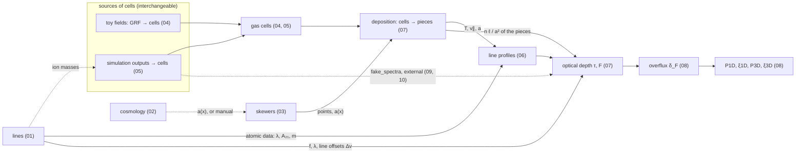
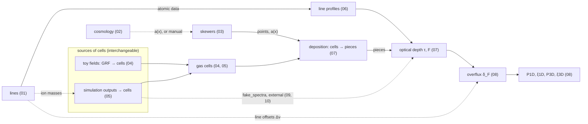

# SkewerJAX

SkewerJAX computes the optical depth τ(v) and the transmitted flux F = e^{−τ} of the Lyman-α forest and of metal
lines (Si III λ1206 and any other transition in its line table) along arbitrary skewers, together with their summary
statistics: the overflux decomposition by line, P1D, ξ1D, P3D and ξ3D. It is written in JAX, so the whole chain can
be compiled, vectorised and differentiated, and it runs on CPUs and GPUs. The gas is one container for every source,
Voronoi gas cells (`core.Cells`): built from Gaussian random fields (toy fields, isotropic or with a Kaiser-like
anisotropy, Fingers of God and a BAO feature) or from hydrodynamical snapshots (Arepo/IllustrisTNG HDF5). A dedicated subpackage
reproduces the scheme of fake_spectra, so that the two codes can be compared option by option.

**Key features**

- **Exact light-cone geometry.** a(x) is integrated along each skewer (diffrax), every line is integrated in its own
  line-centred frame (or directly on a reference line's axis), and the detuning is exact.
- **One field representation, one route for τ.** Toy fields and simulations both produce Voronoi cells (`core.Cells`:
  generating points, volumes and, per species, density, temperature and peculiar velocity). One route takes them to
  τ: selection of the cells along the skewers, deposition into the exact pieces of the cells (`core.Pieces`), and the
  sum of one profile per piece at its centroid. Periodicity is one opt-in option, `velocity_period` (default: none).
  Voigt profiles come from ExoJAX, with a fast first-order expansion in the damping parameter (`voigt="harris"`) as
  the alternative for τ; an FFT convolution and SciPy's Faddeeva function are standalone references (`core.voigt`).
- **JAX-first containers and kernels.** Every container (`LineBundle`, `Cosmology`, `SkewerBundle`, `Cells`,
  `Pieces`, `GasCells`) is a pytree, and the τ sum works under `jit`, `vmap` and `grad`; the geometry (selection,
  deposition) runs on the host.
- **Memory-bounded kernels.** `lax.map` over skewers, a velocity chunk per call, and optional batching.
- **Optional speed-ups.** Sharding of the skewer axis over several devices (`optical_depth_sharded`), and an opt-in
  float32 τ kernel (`dtype="float32"`).
- **Simulation extraction.** Streamed snapshot I/O and k-d tree cell selection, then the core's exact Voronoi
  deposition of the cells along each skewer (a fast path for regular grids of cells). Gas physics: TNG's stored neutral fractions, Rahmati et al. self-shielding for
  star-forming gas, and CLOUDY tables for metal ions.
- **Comparison with fake_spectra.** A matched mode reproduces fake_spectra to |ΔF| ~ 1e-5. An effect chain switches
  every difference on one at a time, and a benchmark harness measures both codes on identical skewers.

## Architecture



Dependencies run one way only. `core` imports nothing from the other subpackages; `summary_stats` (the overflux and
its statistics) imports `core` only. `simulations` holds every source of
gas cells (the toy fields and the snapshots), and the boundary between `simulations` and `core` is `core.Cells`; `core.Pieces`, the constant-property pieces of
every skewer, is what the τ sum runs over. `docs/usage.md` lists the entry points of each
subpackage.

## Quickstart

```python
import jax, jax.numpy as jnp, numpy as np

jax.config.update("jax_enable_x64", True)  # SkewerJAX follows this flag; the validated tolerances are float64
from skewerjax.core import LineBundle, Cosmology, SkewerBundle, grid_skewer_points, phys, compute_optical_depth
from skewerjax.simulations import PowerLawGRF, grf_cells

lines = LineBundle(["HI-LyA", "SiIII-1206"], ref_line_id="HI-LyA")
cosmo = Cosmology(H0=phys.H0, Omega_r_0=0.0, Omega_m_0=1.0, Omega_k_0=0.0, Omega_lambda_0=0.0)
L, z = 50.0, 2.2  # box [cMpc], redshift of the far end
skewers = SkewerBundle(
    spatial_points=grid_skewer_points(L, 4, 1024, direction="y").reshape(16, 1024, 3), cosmologies=cosmo, a0=1 / (1 + z), x0=L
)
grf = PowerLawGRF(A_s=0.04, k_0=2.0, n_s=-1.25, L=(L,) * 3, N=(64,) * 3)  # sigma_delta = 0.2
delta = grf.sample(jax.random.PRNGKey(0))
cells = grf_cells(delta, grf, {"HI": 1e-12, "SiIII": 1e-12 / 50}, temperature=1.5e4)  # the grid cells: n = n_bar (1 + delta)
a_dagger = 1 / (1 + z)
P = float(phys.c_kms * jnp.log(a_dagger / skewers.scale_factors[0, 0, 0]))  # the box in velocity
v = (jnp.arange(512) + 0.5) * P / 512  # one period of the box
tau = compute_optical_depth(
    skewers,
    v,
    lines,
    cells,
    a_dagger=a_dagger,
    resolution_tolerance=None,
    line_frame="reference",  # both lines on the Lya axis
    velocity_period=True,
)  # periodic over the box (default: no wrap)
print(tau.shape, np.exp(-np.asarray(tau)).mean(axis=(1, 2)))  # (2, 16, 512): <F> of Lya and Si III
```

Notebook `00_quickstart` runs the same chain step by step, and continues with the statistics.

## Installation

```bash
git clone --recurse-submodules <repository URL>      # the CLOUDY ion tables are a git submodule
cd SkewerJAX
pip install -e ".[simulations]"                      # CPU; the core alone: pip install -e .
python scripts/verify_install.py
```

| extra | adds | for |
|---|---|---|
| (none) | jax, numpy < 2, scipy, matplotlib, diffrax, exojax | the core: toy fields, τ, statistics, figures |
| `simulations` | h5py | the snapshot readers (Arepo / IllustrisTNG), the result cache |
| `plots` | tol-colors, ipympl | Tol's colour package (a vendored copy is used without it), interactive figures |
| `notebooks` | jupyter, ipykernel, ipympl, ipywidgets, nbconvert | running the notebooks |
| `comparison` | h5py, fake-spectra, psutil | the comparison with fake_spectra and its benchmark |
| `dev` | pytest, pytest-cov, ruff, pre-commit, nbstripout, nbconvert | the tests and the tooling |
| `gpu` | jax[cuda12] | NVIDIA GPUs (see the JAX installation guide for other set-ups) |

Python ≥ 3.11 and JAX ≥ 0.6.2 are required, with NumPy < 2 (an ExoJAX constraint). `docs/installation.md` covers
venv/conda environments, the JAX CPU/GPU builds, the data paths and troubleshooting.

## Notebooks

Two entry points: `00_quickstart` (the whole chain on a toy box, compact) and `00_quickstart_step_by_step` (one
simulated skewer followed from the snapshot to the statistics, one figure and the equations per step). Notebooks
01–10 then open one ingredient each, in the order of the dependency graph (derived from the code; an arrow points
to what needs an ingredient; dashed: optional input or data only; the two field sources are interchangeable):



| notebook | content |
|---|---|
| `00_quickstart` | the whole chain on a toy box: lines, skewers, gas cells, τ and F, P1D |
| `00_quickstart_step_by_step` | a TNG50-4 skewer step by step: the snapshot, the cells it crosses, the fields, line profiles, τ and F (Lyα, Si III) built up stretch by stretch, the lines on one axis, the gas cylinder (`plot_cylinder`), overflux and statistics, with the equations |
| `01_lines` | the line table, `Line` and `LineBundle` attributes, offsets Δv_j and line widths |
| `02_cosmology` | a(x) along light rays against the closed forms, with each background's special point |
| `03_skewers` | `SkewerBundle` conventions; one skewer in 3D with its points, midpoints, dual segments, tangents and line elements, and everything the bundle stores for it |
| `04_fields_and_samplers` | toy fields: Gaussian random fields in 1D/2D/3D, isotropic and with a Kaiser-like anisotropy, Fingers of God and a BAO bump, and their gas cells (`grf_cells`: the cells of the grid; H I and Si III along one skewer in 3D) |
| `05_simulation_outputs` | from a TNG50-4 snapshot to gas cells: the ion-density equations (self-shielding, CLOUDY), the n_H–T plane, and a region of the snapshot as `core.Cells` without skewers (`snapshot_cells`: H I and Si III on the Voronoi cells along one skewer, in 3D), the container of the toy fields |
| `06_voigt_and_line_profiles` | the Voigt function (ExoJAX, FFT convolution, SciPy's Faddeeva function; Gaussian and Lorentzian limits) and the line profiles of gas elements (`core.line_profiles`) |
| `07_deposition_and_optical_depth` | the τ integral as a sum over pieces; from cells to τ step by step on one TNG50-4 skewer through the box centre (selection → deposition into pieces → τ, with the package's own route): the cells in 3D, the pieces, and the same pieces on the ring of s, on the ring of v (periodicity as an option, `velocity_period`) and as their dτ; line-centred frames, the global axis, the observed wavelength and `wrap_to_ref_line` for Lyα and Si III on the same skewer |
| `08_summary_statistics` | bottom-up on toy boxes (`ToyBoxes`: periodic boxes, power law + BAO, isotropic, zero or linear-theory velocities; the model written out once; regenerated from their seeds, everything recomputed every run): A, the fields and their P and ξ (isotropic, (⊥, ∥) planes, μ wedges as DESI DR2) against the exact expectation and the continuous P(k) and ξ(r), with the exact covariance of ξ; B, skewers through every box (`SkewerRun`), where they run and one from the gas to the overflux δ = T / T̄(v) − 1 (the ensemble mean transmission at each pixel); C, the 3D estimator checked on the density, then ξ and kP of the total overflux in the (⊥, ∥) planes (the Si III–Lyα feature at r∥ = Δv), the 3D P and ξ of the Lyα, Si III and total overflux on the lattice of skewers in comoving units (the BAO peak), ξ in μ wedges next to measured Lyα wedges; D, P1D next to DESI DR1, and P1D and ξ1D of the total overflux by term and order |
| `09_comparison_fake_spectra_results` | what the two codes compute on the same TNG50-4 skewer (the gas, τ and above all the flux): the matched mode against fake_spectra, the differences one switch at a time, their root causes and the effect chain |
| `10_comparison_fake_spectra_performance` | speed and memory against fake_spectra: scaling with the number of skewers (1–1024) and the simulation size (TNG50-4, -3, -2), CPU and GPU, the time per stage, host and GPU memory, threads and one core (reads the results file of `scripts/benchmarks/benchmark_fake_spectra.py`, presets `quick` and `full`; `RUN_BENCHMARKS = True` re-runs it) |

Every notebook applies one style (`skewerjax.utils.plotting.use_style()`: the white "paper" style by default,
`use_style("dark")` for the dark one; Paul Tol's colour-blind-safe "bright" colours and colour maps in both, minimum
font sizes). `use_backend()` (interactive ipympl figures in a live notebook) is left commented out in the setup cell.
Every notebook opens with the dependency graph highlighting the ingredients it uses. Notebooks `00_quickstart_step_by_step`, 05, 07 and 09 need TNG50 snapshots, and 10 to re-run its benchmark (see
"Simulation data" in `docs/installation.md`).

## Tests

```bash
pip install -e ".[dev,simulations]"
pytest                                   # the fast default (every test except the `slow` ones; ~5 min with the TNG50-4 data)
pytest -m "slow or not slow"             # everything; markers: slow, tng (needs the snapshots), gpu, fake_spectra
pytest -m "not tng"                      # what the CI runs: no data needed
pre-commit install                       # once: ruff, nbstripout and the file checks on every commit
```

One suite (`tests/`, laid out like the package): unit tests of every module; the physics checks (closed forms of τ,
Voigt limits, a(x) of pure backgrounds, the recovery of input power spectra, jit / vmap of every kernel); the field
extraction and τ on TNG50-4; the comparison with fake_spectra; and a regression of every result against reference
arrays. `tests/README.md` explains the markers and when to regenerate the references
(`scripts/dev/update_regression_references.py`). The benchmark against fake_spectra:

```bash
python scripts/benchmarks/benchmark_fake_spectra.py --sets smoke        # 1 and 4 skewers (~4 min)
python scripts/benchmarks/benchmark_fake_spectra.py --preset quick     # the reduced scaling study (<= 30 min); --preset full: the whole one
```

When a result looks wrong, `skewerjax.core.check_skewers(cells, bundle, lines)` runs independent checks of the pieces
and of τ: coverage of the path, the column against a fine sampling of the cells, and the window integral.
`return_info=True` on the entry points gives counts and timings per stage, and `skewerjax.core.enable_logging()`
shows the package's log messages (see `docs/usage.md`, "Debugging and input checks").

## Benchmark

The two codes run on identical skewers of TNG50 snapshot 25 (z = 3), computing Lyα and Si III λ1206 at 1 km/s
pixels (`scripts/benchmarks/benchmark_fake_spectra.py`, notebook `10_comparison_fake_spectra_performance`, which reads
the summary `benchmarks/results/fake_spectra_benchmark.json`; the raw per-run records go to `benchmarks/raw/`,
git-ignored). The numbers were measured before the revision checkpoint of 2026-10-26, whose streamed selection is about
2.4× faster: SkewerJAX's selection stage and totals are now smaller.
- **Hardware:** Intel i9-13900KF (32 threads), 132 GB RAM, NVIDIA RTX 3060 12 GB, shared with another user's jobs
  during the runs (a few tens of per cent of noise).
- **Software:** JAX 0.6.2, fake_spectra 2.2.4.
- **Method:** one process per configuration, the first run (compilation, cold read) kept apart, median of the timed
  runs, 32 threads, float64 unless stated. SkewerJAX's *matched* mode reproduces fake_spectra's scheme; *default*
  is its own (Voronoi pieces of 0.25 km/s dual segments, exact frame).
- **Presets:** `--preset quick` (the default) is a reduced study in ≤ 30 min of new runs (TNG50-3 and TNG50-2 at
  small N, threads at N = 1); `--preset full` is the whole study (N up to 1024 on the three snapshots, threads at
  N = 16; ten hours or more). The numbers below merge the TNG50-4 series and TNG50-3 up to N = 64 of a partial full run
  with the quick run (26.5 min).

| configuration | fake_spectra | SkewerJAX CPU default | CPU float32 | GPU default | matched max \|ΔF\| / rms ΔF, Lyα |
|---|---|---|---|---|---|
| TNG50-4, 1 skewer | 1.7 s | 3.0 s | 2.1 s | 4.6 s | 1.9e-5 / 2.6e-6 |
| TNG50-4, 16 skewers | 3.0 s | 33 s | 18 s | 59 s | 2.2e-4 / 4.6e-6 |
| TNG50-4, 256 skewers | 6.9 s | 451 s | 197 s | — | 2.2e-4 / 2.9e-6 |
| TNG50-3, 1 skewer | 32 s (two runs: 20 and 44 s) | 15 s | — | 15 s | 2.1e-5 / 3.0e-6 |
| TNG50-3, 16 skewers | 25 s | 83 s | — | 87 s | 1.9e-4 / 4.8e-6 |
| TNG50-2, 1 skewer | 151 s | not measured: > 600 s for the first + one timed run (left for the full preset) | — | — | — |

- **Scaling:** SkewerJAX's time is linear in the number of skewers (≈ 1.8 s per skewer on the CPU, mostly the exact
  Voigt sum over every piece and pixel). fake_spectra's is dominated by passes over the whole snapshot: nearly flat in
  N and linear in the snapshot size. So fake_spectra is 1.7× to 65× faster on TNG50-4, while on TNG50-3 SkewerJAX is
  faster for one skewer.
- **Levers:** float32 halves SkewerJAX's time; on this consumer GPU it is slower than on the CPU; 1 → 32 threads gives
  about 6×.
- **Memory:** fake_spectra uses ≈ 1 GB whatever N; SkewerJAX's default grows by ≈ 80 MB per skewer (20.6 GB at 256).
- **Agreement while timed:** matched-mode rms ΔF ≤ 5e-6 (Lyα and Si III); the max |ΔF| at N ≥ 16 comes from one pixel
  of one skewer per line.

## Repository layout

```
skewerjax/            the package
  core/               lines, constants, cosmology, skewers, gas cells, selection, deposition, absorbers (cells -> pieces),
                      Voigt, line profiles, spectral frames, optical depth (incl. sharding), closed forms,
                      input checks (validation) and diagnostics (check_skewers)
  summary_stats/      the overflux (overflux), the order-by-order decomposition (orders), P1D/xi1D (stats_1d),
                      P3D/xi3D by term (stats_3d), P and xi of 3D grids: isotropic, (par, perp), mu wedges (grid3d),
                      shared conventions and binning (fourier, binning), metal-contamination models (contaminants)
  simulations/        the sources of gas cells: toy fields (PowerLawGRF, grf_cells) and snapshots (readers, gas physics,
                      streamed selection, snapshot_cells, SimulationSkewers, maps)
    cloudy_tables/    CLOUDY ionisation tables (git submodule sbird/cloudy_tables)
  comparison/         fake_spectra emulation, matched options and effect chain, fake_spectra driver, benchmark
  utils/              plotting (style, figures), paths (data, cache and benchmark folders)
notebooks/            00-10 tutorials (committed with outputs cleared)
tests/                one pytest suite: core/, summary_stats/, simulations/, utils/, comparison/, regression/ (+ data/); README.md
benchmarks/
  results/            the benchmark summary read by notebook 10 (committed)
  raw/                the per-run records (git-ignored)
scripts/
  benchmarks/         benchmark_fake_spectra.py
  dev/                update_regression_references.py, check_markdown_math.py, run_tests.py (+ pytest_shim: the suite
                      without pytest)
  figures/            optical_depth_vs_analytic.py
  verify_install.py   environment smoke test
docs/                 installation.md, usage.md
```

## References and acknowledgements

- fake_spectra: S. Bird, *FSFE: Fake Spectra Flux Extractor*, Astrophysics Source Code Library, ascl:1710.012 (2017).
  SkewerJAX's comparison subpackage runs it and reproduces its scheme.
- P. McDonald et al., *The Lyα Forest Power Spectrum from the Sloan Digital Sky Survey*, ApJS 163, 80 (2006),
  doi:10.1086/444361. The Si III cross-term model (`summary_stats.mcdonald_factor`).
- K. Ma, J. S. Bolton, V. Iršič, P. Gaikwad, E. Puchwein, *An improved model for the effect of correlated Si III
  absorption on the one-dimensional Lyman-α forest power spectrum*, MNRAS 546, staf2262 (2026),
  doi:10.1093/mnras/staf2262 (`summary_stats.ma_factor`).
- N. G. Karaçaylı et al., *A framework to measure the properties of intergalactic metal systems with two-point flux
  statistics*, MNRAS 522, 5980 (2023), doi:10.1093/mnras/stad1363.
- Built on JAX, diffrax (the a(x) integration) and ExoJAX (the Voigt profile). Simulation data: IllustrisTNG (TNG50).

## License

MIT (see `LICENSE`).
