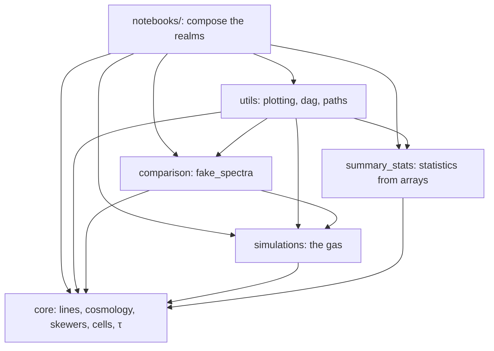
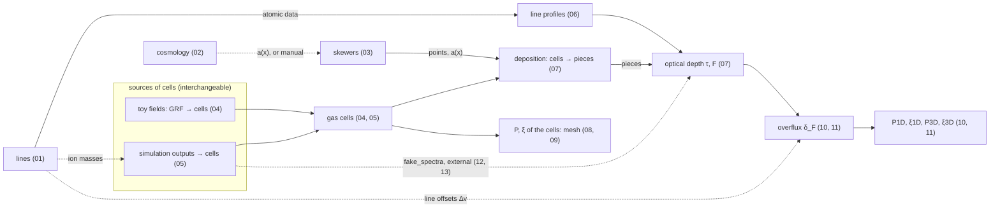

# SkewerJAX

SkewerJAX computes the optical depth τ(v) and the transmitted flux F = e^{−τ} of the Lyman-α forest and of metal
lines (Si III λ1206, Si II λ1193 and λ1190, and any other transition in its line table: any number of lines at once) along
arbitrary skewers, together with their summary statistics: the overflux decomposition by line and order, P1D, ξ1D, P3D
and ξ3D, and P and ξ of the density of the gas cells themselves. It is written in JAX, so the whole chain can
be compiled, vectorised and differentiated, and it runs on CPUs and GPUs. The gas is one container for every source,
Voronoi gas cells (`core.Cells`): built from Gaussian random fields (toy fields, isotropic or with a Kaiser-like
anisotropy, Fingers of God and a BAO feature) or from hydrodynamical snapshots (Arepo/IllustrisTNG HDF5). A dedicated subpackage
takes each choice of fake_spectra as an option, so that the two codes can be compared one switch at a time.

**Key features**

- **Exact light-cone geometry.** a(x) is integrated along each skewer (diffrax), every line is integrated in its own
  line-centred frame (or directly on a reference line's axis), and the detuning is exact.
- **One field representation, one route for τ.** Toy fields and simulations both produce Voronoi cells (`core.Cells`:
  generating points, volumes and, per species, density, temperature and peculiar velocity). One route takes them to
  τ: selection of the cells along the skewers, deposition into the exact pieces of the cells (`core.Pieces`), and the
  sum of one profile per piece at its centroid. Periodicity is one opt-in option, `velocity_period` (default: none).
  Voigt profiles come from ExoJAX, with a fast first-order expansion in the damping parameter (`voigt="harris"`) as
  the alternative for τ; an FFT convolution and SciPy's Faddeeva function are standalone references (`core.voigt`).
- **JAX-first containers and kernels.** Every container (`LineBundle`, `Cosmology`, `SkewerBundle`, `Cells`,
  `Pieces`, `GasCells`) is a pytree, and the τ sum works under `jit`, `vmap` and `grad`; the geometry (selection,
  deposition) runs on the host.
- **Memory-bounded kernels.** `lax.map` over skewers, a velocity chunk per call, and optional batching.
- **Optional speed-ups.** Sharding of the skewer axis over several devices (`optical_depth_sharded`), and an opt-in
  float32 τ kernel (`dtype="float32"`).
- **Simulation extraction.** Streamed snapshot I/O and k-d tree cell selection, then the core's exact Voronoi
  deposition of the cells along each skewer (a fast path for regular grids of cells). Gas physics: TNG's stored neutral fractions, Rahmati et al. self-shielding for
  star-forming gas, and CLOUDY tables for metal ions.
- **Comparison with fake_spectra.** Every choice of fake_spectra is one option of a SkewerJAX function. Notebook 12 runs
  fake_spectra natively, shows the fully matched mode and tests each option on its own, from both ends, and a benchmark harness measures
  both codes on identical skewers. Environment: `envs/skewerjax-fs.yml`, steps in [`docs/installation.md`](docs/installation.md).

## Architecture

The diagrams, the tree and the table below are generated from one specification, `skewerjax/utils/dag.py`, which also
draws the dependency graph of the notebooks (`plot_dag`): `python scripts/dev/make_diagrams.py` rewrites them, and
`tests/utils/test_dag.py` checks the specification against the code and this README against the specification.

**(a) Layers.** Dependencies run one way only. `core` (lines, cosmology, the paths: `SkewerBundle` and lattices of
skewers, gas cells, τ) imports nothing from the other subpackages, and two realms sit on it, neither importing the other
(`tests/test_import_graph.py`): `simulations` (the gas: every source of gas cells, the toy fields and the snapshots; the
boundary with `core` is `core.Cells`) and `summary_stats` (the overflux and every statistic, from arrays, geometry and
`core.Cells`, an expectation passed as a callable P(k)). `comparison` and `utils` (plotting) build on them; notebooks compose them. An
arrow points from the importer to what it imports.

<!-- BEGIN generated:layers -->

<!-- END generated:layers -->

**(b) Pipeline.** The ingredients (boxes: what, plain text, module), grouped by realm; every arrow is a dependency of the
code, labelled with the functions that implement it and the array it carries (dotted: optional or data only).
`core.Pieces`, the constant-property pieces of every skewer, is what the τ sum runs over. The statistics of 3D fields
take the samples of the skewers on their own lattice (exact FFT, and they refuse `mas` and `interlace`), or the fields of gas
cells through a mesh: mass assignment (NGP, CIC, TSC, PCS), interlacing and the window divided (`summary_stats.mesh`;
Sefusatti et al. 2016).

```mermaid
flowchart LR
    subgraph core_band["core"]
        lines["<b>lines</b><br/>LineBundle<br/><code>core.lines</code>"]
        cosmology["<b>cosmology</b><br/>Cosmology, a(x)<br/><code>core.cosmology</code>"]
        skewers["<b>skewers</b><br/>SkewerBundle; lattice of paths<br/><code>core.skewers</code>"]
        fields["<b>gas cells</b><br/>Cells: n, T, v<br/><code>core.cells</code>"]
        deposition["<b>deposition</b><br/>cells → pieces<br/><code>core.absorbers, core.deposition</code>"]
        profiles["<b>line profiles</b><br/>Voigt φ_j(v) per piece<br/><code>core.line_profiles</code>"]
        tau["<b>optical depth</b><br/>τ(v), T = e^−τ<br/><code>core.optical_depth</code>"]
    end
    subgraph simulations_band["simulations"]
        samplers["<b>toy fields</b><br/>PowerLawGRF → cells<br/><code>simulations.grf, simulations.toy_cells</code>"]
        simulation["<b>simulation outputs</b><br/>TNG snapshot → cells<br/><code>simulations.snapshot_cells</code>"]
    end
    subgraph summary_stats_band["summary_stats"]
        normalisation["<b>mean transmission</b><br/>T̄ = ⟨T⟩ over a set of pixels<br/><code>summary_stats.overflux</code>"]
        overflux["<b>overflux</b><br/>δ = T/T̄ − 1, per line and total<br/><code>summary_stats.overflux</code>"]
        stats_1d["<b>1D statistics</b><br/>P1D, ξ1D (by order and term)<br/><code>summary_stats.lattice, summary_stats.stats_1d</code>"]
        stats_3d["<b>3D statistics</b><br/>P3D, ξ3D on the lattice of skewers<br/><code>summary_stats.lattice, summary_stats.grid3d</code>"]
        field_stats["<b>field statistics</b><br/>P, ξ of the cells' density: mesh (MAS + interlacing)<br/><code>summary_stats.field_stats, summary_stats.mesh</code>"]
    end
    cosmology -.->|"SkewerBundle<br/>a(x)"| skewers
    lines -.->|"Ion, get_mass_amu"| simulation
    samplers -->|"grf_cells<br/>Cells (N³)"| fields
    simulation -->|"snapshot_cells<br/>Cells (N_cells)"| fields
    fields -->|"cell_pieces, voronoi_segments"| deposition
    skewers -->|"bundle_frame, lattice_points<br/>points (N_sk, N_pt, 3)"| deposition
    deposition -->|"optical_depth_kernel"| profiles
    deposition -->|"compute_optical_depth<br/>Pieces (N_lines, N_sk, N_p)"| tau
    lines -->|"voigt_widths_GHz"| profiles
    lines -->|"frequency_offset_GHz, wrap_to_ref_line"| tau
    profiles -->|"line_profiles"| tau
    tau -->|"ensemble_mean_transmissions<br/>τ (N_lines, N_sk, N_v)"| normalisation
    normalisation -->|"DeltaFieldBuilder<br/>T̄ (N_lines + 1, N_sk, N_v)"| overflux
    overflux -->|"skewer_p1d, skewer_xi1d, decompose_1d<br/>δ (N_lines + 1, N_sk, N_v)"| stats_1d
    overflux -->|"measure_lattice<br/>δ on (n_x, N_v, n_z)"| stats_3d
    fields -->|"cell_weights, fourier_mesh<br/>n_X V (N_cells) → mesh (N_mesh³)"| field_stats
```

<!-- BEGIN generated:pipeline -->

<!-- END generated:pipeline -->

**(c) Modules**, with the first sentence of each docstring.

<!-- BEGIN generated:tree -->
```
skewerjax/                    # SkewerJAX: absorption along skewers (tau, F = exp(-tau)) for many transitions, and …
├── comparison/               # Block C, comparison with fake_spectra: what remains is the benchmark of the two …
│   └── benchmark.py          # Wall time and memory of SkewerJAX against fake_spectra on identical skewers (Lya …
├── core/                     # Block A, the core backbone: lines, cosmology, skewers, gas cells, the route cells …
│   ├── absorbers.py          # Absorbers: the deposited pieces of every skewer, their frame a(s), and the pieces …
│   ├── analytic.py           # Closed-form optical depths of uniform gas (review notes): the validation targets …
│   ├── cells.py              # Gas cells: the one representation of the gas, whatever its source (toy models or …
│   ├── constants.py          # Physical constants and unit conversions (``phys``)
│   ├── cosmology.py          # Background cosmology: the scale factor along a photon path, a(x) (review notes)
│   ├── deposition.py         # Deposition: the pieces of the path, i.e. which cell lies on the dual segment of …
│   ├── diagnostics.py        # Debugging tools: what to call when a result looks wrong
│   ├── line_profiles.py      # Line profiles: the widths and the normalised profile phi(nu) of every transition …
│   ├── lines.py              # Atomic transitions: the line table (``LINES``) and ``LineBundle``, the lines of …
│   ├── optical_depth.py      # Line profiles and the optical depth tau(v) along skewers (review notes, Eqs. …
│   ├── selection.py          # Cell selection: the cells within reach of a set of paths (periodic k-d tree), for …
│   ├── skewers.py            # Skewers: the sampling points of a set of sightlines, their geometry and their …
│   ├── spectral.py           # Spectral coordinates: the observer's velocity v_dagger, local wavelengths lambda' …
│   ├── validation.py         # Input validation shared by the entry points: informative errors for non-finite or …
│   └── voigt.py              # The Voigt function V(x; sigma, gamma) = (G * L)(x) (review notes, Eq. …
├── simulations/              # Block B, the field sources: everything that produces the gas cells of the core …
│   ├── gas_cells.py          # Gas cells (layer 2): a format-independent pytree of gas elements in physical units
│   ├── gas_physics.py        # Gas physics (layer 3): per-cell n_H, T, ion fractions and ion densities (JAX), and …
│   ├── grf.py                # Toy field source: power-law Gaussian random fields (``PowerLawGRF``) in 1D, 2D and …
│   ├── maps.py               # Maps of the gas for figures: the projection of a slab of a snapshot, streamed in …
│   ├── readers.py            # Snapshot readers (layer 1): format-specific HDF5 I/O and units, NumPy only
│   ├── selection.py          # Cell selection (layer 4): streaming k-d tree selection of the gas cells of a …
│   ├── snapshot_cells.py     # The snapshot as gas cells, without skewers: the cells of a region of the box after …
│   ├── snapshot_skewers.py   # Skewers through a simulation snapshot: the gas cells, columns and tau for any …
│   ├── toy_boxes.py          # Toy boxes (notebooks 08 and 10): periodic 3D Gaussian fields of known spectrum and …
│   └── toy_cells.py          # Toy field source: the gas cells of a Gaussian random field (``grf_cells``)
├── summary_stats/            # The summary statistics of the flux: the overflux of each line and of their …
│   ├── binning.py            # Binning of the two-point statistics: bin indices, jitted weighted bin means, bin …
│   ├── contaminants.py       # P1D metal-contamination models (McDonald et al. 2006; Ma et al.) and their fits to …
│   ├── density.py            # The density sampled along a lattice of periodic skewers (notebook 10, Part B) …
│   ├── field_stats.py        # P and xi of the density of gas cells in a periodic box, over an ensemble of …
│   ├── fourier.py            # The Fourier conventions of the two-point statistics: lag and mode axes, and the …
│   ├── grid3d.py             # Two-point statistics of a periodic 3D field on a grid, and their exact …
│   ├── lattice.py            # Two-point statistics of an ensemble of periodic skewers, from arrays and geometry …
│   ├── mesh.py               # Points on a periodic mesh: mass assignment, interlacing and the window correction …
│   ├── orders.py             # The order-by-order decomposition of the total overflux into its subset terms
│   ├── overflux.py           # The transmission T = exp(-tau) and the overflux (flux-contrast) fields delta of …
│   ├── stats_1d.py           # P1D and xi1D of overflux fields: total, per line pair and per order …
│   ├── stats_3d.py           # P3D and xi3D of overflux fields on a regular grid of skewers …
│   └── theory.py             # Theory helpers of the statistics of a periodic box: what an isotropic xi(r) or …
└── utils/                    # Utilities outside the three blocks: the shared plotting style and figure helpers …
    ├── dag.py                # The architecture of SkewerJAX as data: one specification of the dependency graph …
    ├── paths.py              # Where SkewerJAX looks for data that is not part of the package: one place, each …
    ├── plotting.py           # Shared plotting style and figure helpers
    └── reference_data.py     # Reference measurements for visual comparisons in the notebooks (not used in any …
```
<!-- END generated:tree -->

**(d) Concepts**: where each ingredient lives and which notebooks show it. `docs/usage.md` lists the entry points of each
subpackage.

<!-- BEGIN generated:concepts -->
| Concept | Module | Key functions and classes | Notebooks |
|---|---|---|---|
| lines: LineBundle | `core.lines` | `LineBundle`, `get_line`, `get_mass_amu` | 01 |
| cosmology: Cosmology, a(x) | `core.cosmology` | `Cosmology` | 02 |
| skewers: SkewerBundle; lattice of paths | `core.skewers` | `SkewerBundle`, `lattice_columns`, `lattice_points` | 03, 10, 11 |
| toy fields: PowerLawGRF → cells | `simulations.grf`, `simulations.toy_cells` | `PowerLawGRF`, `grf_cells` | 04, 08 |
| simulation outputs: TNG snapshot → cells | `simulations.snapshot_cells` | `snapshot_cells`, `select_cells_in_region` | 05, 09, 11 |
| gas cells: Cells: n, T, v | `core.cells` | `Cells`, `cells_on_grid` | 04, 05, 08, 09, 11 |
| deposition: cells → pieces | `core.absorbers`, `core.deposition` | `cell_pieces`, `voronoi_segments`, `absorber_pieces` | 07 |
| line profiles: Voigt φ_j(v) per piece | `core.line_profiles` | `line_profiles`, `voigt_widths_GHz` | 06 |
| optical depth: τ(v), T = e^−τ | `core.optical_depth` | `compute_optical_depth`, `Pieces` | 07, 10, 11 |
| mean transmission: T̄ = ⟨T⟩ over a set of pixels | `summary_stats.overflux` | `ensemble_mean_transmissions`, `mean_transmissions` | 10, 11 |
| overflux: δ = T/T̄ − 1, per line and total | `summary_stats.overflux` | `DeltaFieldBuilder`, `overflux_check` | 10, 11 |
| 1D statistics: P1D, ξ1D (by order and term) | `summary_stats.lattice`, `summary_stats.stats_1d` | `skewer_p1d`, `skewer_xi1d`, `decompose_1d` | 10, 11 |
| 3D statistics: P3D, ξ3D on the lattice of skewers | `summary_stats.lattice`, `summary_stats.grid3d` | `lattice_grid`, `measure_lattice`, `GridStatistics3D` | 10, 11 |
| field statistics: P, ξ of the cells' density: mesh (MAS + interlacing) | `summary_stats.field_stats`, `summary_stats.mesh` | `field_statistics`, `cell_weights`, `fourier_mesh` | 08, 09, 11 |
| fake_spectra: external reference | `comparison.benchmark` | `run_fake_spectra` | 12, 13 |
<!-- END generated:concepts -->

## Quickstart

```python
import jax, jax.numpy as jnp, numpy as np

jax.config.update("jax_enable_x64", True)  # SkewerJAX follows this flag; the validated tolerances are float64
from skewerjax.core import LineBundle, Cosmology, SkewerBundle, grid_skewer_points, phys, compute_optical_depth
from skewerjax.simulations import PowerLawGRF, grf_cells

lines = LineBundle(["HI-LyA", "SiIII-1206"], ref_line_id="HI-LyA")
cosmo = Cosmology(H0=phys.H0, Omega_r_0=0.0, Omega_m_0=1.0, Omega_k_0=0.0, Omega_lambda_0=0.0)
L, z = 50.0, 2.2  # box [cMpc], redshift of the far end
skewers = SkewerBundle(
    spatial_points=grid_skewer_points(L, 4, 1024, direction="y").reshape(16, 1024, 3), cosmologies=cosmo, a0=1 / (1 + z), x0=L
)
grf = PowerLawGRF(A_s=0.04, k_0=2.0, n_s=-1.25, L=(L,) * 3, N=(64,) * 3)  # sigma_delta = 0.2
delta = grf.sample(jax.random.PRNGKey(0))
cells = grf_cells(delta, grf, {"HI": 1e-12, "SiIII": 1e-12 / 50}, temperature=1.5e4)  # the grid cells: n = n_bar (1 + delta)
a_dagger = 1 / (1 + z)
P = float(phys.c_kms * jnp.log(a_dagger / skewers.scale_factors[0, 0, 0]))  # the box in velocity
v = (jnp.arange(512) + 0.5) * P / 512  # one period of the box
tau = compute_optical_depth(
    skewers,
    v,
    lines,
    cells,
    a_dagger=a_dagger,
    resolution_tolerance=None,
    line_frame="reference",  # both lines on the Lya axis
    velocity_period=True,
)  # periodic over the box (default: no wrap)
print(tau.shape, np.exp(-np.asarray(tau)).mean(axis=(1, 2)))  # (2, 16, 512): <F> of Lya and Si III
```

Notebook `00_quickstart` runs the same chain step by step, and continues with the statistics.

## Installation

```bash
git clone --recurse-submodules <repository URL>      # the CLOUDY ion tables are a git submodule
cd SkewerJAX
pip install -e ".[simulations]"                      # CPU; the core alone: pip install -e .
python scripts/verify_install.py
```

| extra | adds | for |
|---|---|---|
| (none) | jax, numpy < 2, scipy, matplotlib, diffrax, exojax | the core: toy fields, τ, statistics, figures |
| `simulations` | h5py | the snapshot readers (Arepo / IllustrisTNG), the result cache |
| `plots` | tol-colors, ipympl | Tol's colour package (a vendored copy is used without it), interactive figures |
| `notebooks` | jupyter, ipykernel, ipympl, ipywidgets, nbconvert | running the notebooks |
| `comparison` | h5py, fake-spectra, psutil | the comparison with fake_spectra and its benchmark |
| `dev` | pytest, pytest-cov, ruff, pre-commit, nbstripout, nbconvert | the tests and the tooling |
| `gpu` | jax[cuda12] | NVIDIA GPUs (see the JAX installation guide for other set-ups) |

Python ≥ 3.11 and JAX ≥ 0.6.2 are required, with NumPy < 2 (an ExoJAX constraint). `docs/installation.md` covers
venv/conda environments, the JAX CPU/GPU builds, the data paths and troubleshooting.

## Notebooks

Two entry points: `00_quickstart` (the whole chain on a toy box, compact) and `00_quickstart_step_by_step` (one
simulated skewer followed from the snapshot to the statistics, one figure and the equations per step). Notebooks
01–07 then open one ingredient each, 08 and 09 measure the statistics of the gas cells (toy boxes, TNG50-4), 10 and 11 the
summary statistics on skewers (toy boxes, TNG50-4), 12 and 13 compare with fake_spectra, in the order of the dependency graph (derived from the code; an arrow points
to what needs an ingredient; dashed: optional input or data only; the two field sources are interchangeable):



| notebook | content |
|---|---|
| `00_quickstart` | the whole chain on a toy box: lines, skewers, gas cells, τ and F, P1D |
| `00_quickstart_step_by_step` | a TNG50-4 skewer step by step: the snapshot, the cells it crosses, the fields, line profiles, τ and F (Lyα, Si III) built up stretch by stretch, the lines on one axis, the gas cylinder (`plot_cylinder`), overflux and statistics, with the equations |
| `01_lines` | the line table, `Line` and `LineBundle` attributes, offsets Δv_j and line widths |
| `02_cosmology` | a(x) along light rays against the closed forms, with each background's special point |
| `03_skewers` | `SkewerBundle` conventions; one skewer in 3D with its points, midpoints, dual segments, tangents and line elements, and everything the bundle stores for it |
| `04_fields_and_samplers` | toy fields: Gaussian random fields in 1D/2D/3D, isotropic and with a Kaiser-like anisotropy, Fingers of God and a BAO bump, and their gas cells (`grf_cells`: the cells of the grid; H I and Si III along one skewer in 3D) |
| `05_simulation_outputs` | from a TNG50-4 snapshot to gas cells: the ion-density equations (self-shielding, CLOUDY), the n_H–T plane, and a region of the snapshot as `core.Cells` without skewers (`snapshot_cells`: H I and Si III on the Voronoi cells along one skewer, in 3D), the container of the toy fields |
| `06_voigt_and_line_profiles` | the Voigt function (ExoJAX, FFT convolution, SciPy's Faddeeva function; Gaussian and Lorentzian limits) and the line profiles of gas elements (`core.line_profiles`) |
| `07_deposition_and_optical_depth` | the τ integral as a sum over pieces; from cells to τ step by step on one TNG50-4 skewer through the box centre (selection → deposition into pieces → τ, with the package's own route): the cells in 3D, the pieces, and the same pieces on the ring of s, on the ring of v (periodicity as an option, `velocity_period`) and as their dτ; line-centred frames, the global axis, the observed wavelength and `wrap_to_ref_line` for Lyα and Si III on the same skewer |
| `08_toy_field_statistics` | the toy boxes (`ToyBoxes`: periodic boxes, power law + Gaussian BAO bump (valid below R_max), isotropic, zero or linear-theory velocities; the model written out once; regenerated from their seeds, everything recomputed every run) and their statistics: A, the fields and their P and ξ in explicit bins (isotropic, (⊥, ∥) planes on the grid's own modes and separations, μ wedges as DESI DR2), the cells through a mesh (`field_statistics`: PCS, interlaced; the trusted range k < k_Nyq/2, r ≥ 6H), against the exact expectation and the continuous P(k) and closed-form ξ(r), with the exact covariance of ξ |
| `09_field_statistics_tng` | the statistics of 08 on the cells of TNG50-4 (snapshot 25): the total gas, H I, Si III and Si II through the same mesh, real space and redshift space along each axis (the three orientations as the ensemble), the header's cosmology against IllustrisTNG's, r_d (Aubourg et al. 2015) and its periodic images (r_d > L/2) |
| `10_skewer_statistics` | the summary statistics on skewers through the toy boxes of 08 (regenerated with the same configuration): A, skewers through every box, step by step (`SkewerBundle`, cells, pieces, τ); B, the (k⊥, k∥) and (r⊥, r∥) planes of the density on the same skewers against their exact expectation; C, the normalisation (the statistics from arrays), where the skewers run and one from the gas to the overflux δ = T / T̄ − 1 (the mean transmission of the ensemble per redshift, `mean="redshift"`; also "global", "box", "skewer"); D, P and ξ of the total overflux in the (k⊥, k∥) and (r⊥, r∥) planes on the lattice's own modes and separations (the Si III–Lyα spot at Δv_{Lyα–Si III}/u and the echoes of the BAO ring; four lines: a spot for every pair), the 3D P and ξ of the overflux of every line and of the total on the lattice of skewers in comoving units (the BAO peak), ξ in μ wedges with r_BAO, the spot and the echoes per wedge; E, the relations of P1D and ξ1D to the 3D statistics, P1D next to DESI DR1, and P1D and ξ1D of the total overflux by term and order |
| `11_skewer_statistics_tng` | the statistics of 10 on TNG50-4 (snapshot 25, z = 3.008, L = 51.7 cMpc): 32 × 32 periodic skewers along each axis in the snapshot frame (the three lines of sight as the ensemble, not independent), points every 0.5 km/s (the resolution check passes), 256 pixels; four lines (Lyα, Si III, Si II 1193, 1190); B, the density of H I, Si III, Si II and their sum on the skewers against the whole box through a mesh (`field_statistics`, PCS, interlaced); C, the transmission and overflux (one mean: one snapshot); D, the (k⊥, k∥) and (r⊥, r∥) planes with a spot for every pair of lines, P, r²ξ and wedges, the BAO scale r_d through its periodic images, P1D next to DESI DR1 at z = 3.0, by order (0 to 8) and term by term |
| `12_comparison_fake_spectra_results` | what the two codes compute on the same TNG50-2 skewers (kernel `skewerjax-fs`): the core calls with the defaults, native fake_spectra, the fully matched mode; each option on its own, from the default and from the matched mode (explicit calls, the two expressions and four curves per step); the root causes, generated from the run, with what each option changes on this skewer and its accuracy, impact and expected cost; what to adopt, what is a choice, what to time |
| `13_comparison_fake_spectra_performance` | speed and memory against fake_spectra: scaling with the number of skewers (1–1024) and the simulation size (TNG50-4, -3, -2), CPU and GPU, the time per stage, host and GPU memory, threads and one core (reads the results file of `scripts/benchmarks/benchmark_fake_spectra.py`, presets `quick` and `full`; `RUN_BENCHMARKS = True` re-runs it) |

Every notebook applies one style (`skewerjax.utils.plotting.use_style()`: the white "paper" style by default,
`use_style("dark")` for the dark one; Paul Tol's colour-blind-safe "bright" colours and colour maps in both, minimum
font sizes). `use_backend()` (interactive ipympl figures in a live notebook) is left commented out in the setup cell.
Every notebook opens with the dependency graph highlighting the ingredients it uses. Notebooks `00_quickstart_step_by_step`, 05, 07, 09, 11 and 12 need TNG50 snapshots, and 13 to re-run its benchmark (see
"Simulation data" in `docs/installation.md`).

## Tests

```bash
pip install -e ".[dev,simulations]"
pytest                                   # the fast default (every test except the `slow` ones; ~5 min with the TNG50-4 data)
pytest -m "slow or not slow"             # everything; markers: slow, tng (needs the snapshots), gpu, fake_spectra
pytest -m "not tng"                      # what the CI runs: no data needed
pre-commit install                       # once: ruff, nbstripout and the file checks on every commit
```

One suite (`tests/`, laid out like the package): unit tests of every module; the physics checks (closed forms of τ,
Voigt limits, a(x) of pure backgrounds, the recovery of input power spectra, jit / vmap of every kernel); the field
extraction and τ on TNG50-4; the comparison with fake_spectra; and a regression of every result against reference
arrays. `tests/README.md` explains the markers and when to regenerate the references
(`scripts/dev/update_regression_references.py`). The benchmark against fake_spectra:

```bash
python scripts/benchmarks/benchmark_fake_spectra.py --sets smoke        # 1 and 4 skewers (~4 min)
python scripts/benchmarks/benchmark_fake_spectra.py --preset quick     # the reduced scaling study (<= 30 min); --preset full: the whole one
```

When a result looks wrong, `skewerjax.core.check_skewers(cells, bundle, lines)` runs independent checks of the pieces
and of τ: coverage of the path, the column against a fine sampling of the cells, and the window integral.
`return_info=True` on the entry points gives counts and timings per stage, and `skewerjax.core.enable_logging()`
shows the package's log messages (see `docs/usage.md`, "Debugging and input checks").

## Benchmark

The two codes run on identical skewers of TNG50 snapshot 25 (z = 3), computing Lyα and Si III λ1206 at 1 km/s
pixels (`scripts/benchmarks/benchmark_fake_spectra.py`, notebook `13_comparison_fake_spectra_performance`, which reads
the summary `benchmarks/results/fake_spectra_benchmark.json`; the raw per-run records go to `benchmarks/raw/`,
git-ignored). The numbers were measured before the revision checkpoint of 2026-10-26, whose streamed selection is about
2.4× faster: SkewerJAX's selection stage and totals are now smaller.
- **Hardware:** Intel i9-13900KF (32 threads), 132 GB RAM, NVIDIA RTX 3060 12 GB, shared with another user's jobs
  during the runs (a few tens of per cent of noise).
- **Software:** JAX 0.6.2, fake_spectra 2.2.4.
- **Method:** one process per configuration, the first run (compilation, cold read) kept apart, median of the timed
  runs, 32 threads, float64 unless stated. SkewerJAX's *matched* mode reproduces fake_spectra's scheme; *default*
  is its own (Voronoi pieces of 0.25 km/s dual segments, exact frame).
- **Presets:** `--preset quick` (the default) is a reduced study in ≤ 30 min of new runs (TNG50-3 and TNG50-2 at
  small N, threads at N = 1); `--preset full` is the whole study (N up to 1024 on the three snapshots, threads at
  N = 16; ten hours or more). The numbers below merge the TNG50-4 series and TNG50-3 up to N = 64 of a partial full run
  with the quick run (26.5 min).

| configuration | fake_spectra | SkewerJAX CPU default | CPU float32 | GPU default | matched max \|ΔF\| / rms ΔF, Lyα |
|---|---|---|---|---|---|
| TNG50-4, 1 skewer | 1.7 s | 3.0 s | 2.1 s | 4.6 s | 1.9e-5 / 2.6e-6 |
| TNG50-4, 16 skewers | 3.0 s | 33 s | 18 s | 59 s | 2.2e-4 / 4.6e-6 |
| TNG50-4, 256 skewers | 6.9 s | 451 s | 197 s | — | 2.2e-4 / 2.9e-6 |
| TNG50-3, 1 skewer | 32 s (two runs: 20 and 44 s) | 15 s | — | 15 s | 2.1e-5 / 3.0e-6 |
| TNG50-3, 16 skewers | 25 s | 83 s | — | 87 s | 1.9e-4 / 4.8e-6 |
| TNG50-2, 1 skewer | 151 s | not measured: > 600 s for the first + one timed run (left for the full preset) | — | — | — |

- **Scaling:** SkewerJAX's time is linear in the number of skewers (≈ 1.8 s per skewer on the CPU, mostly the exact
  Voigt sum over every piece and pixel). fake_spectra's is dominated by passes over the whole snapshot: nearly flat in
  N and linear in the snapshot size. So fake_spectra is 1.7× to 65× faster on TNG50-4, while on TNG50-3 SkewerJAX is
  faster for one skewer.
- **Levers:** float32 halves SkewerJAX's time; on this consumer GPU it is slower than on the CPU; 1 → 32 threads gives
  about 6×.
- **Memory:** fake_spectra uses ≈ 1 GB whatever N; SkewerJAX's default grows by ≈ 80 MB per skewer (20.6 GB at 256).
- **Agreement while timed:** matched-mode rms ΔF ≤ 5e-6 (Lyα and Si III); the max |ΔF| at N ≥ 16 comes from one pixel
  of one skewer per line.

## Repository layout

```
skewerjax/            the package
  core/               lines, constants, cosmology, skewers, gas cells, selection, deposition, absorbers (cells -> pieces),
                      Voigt, line profiles, spectral frames, optical depth (incl. sharding), closed forms,
                      input checks (validation) and diagnostics (check_skewers)
  summary_stats/      the overflux (overflux), the order-by-order decomposition (orders), P1D/xi1D (stats_1d),
                      P3D/xi3D by term (stats_3d), P and xi of 3D grids: isotropic, (par, perp), mu wedges (grid3d),
                      shared conventions and binning (fourier, binning), metal-contamination models (contaminants),
                      statistics on a lattice of skewers (lattice), 3D fields over an ensemble (field_stats), the
                      density along skewers and its exact expectation (density), points on a mesh: mass assignment,
                      interlacing, the window (mesh)
  skewers/            lattices of skewers: columns and points of a SkewerBundle (lattice), the Hubble velocity (frame)
  simulations/        the sources of gas cells: toy fields (PowerLawGRF, grf_cells, ToyBoxes) and snapshots (readers, gas physics,
                      streamed selection, snapshot_cells, SimulationSkewers, maps)
    cloudy_tables/    CLOUDY ionisation tables (git submodule sbird/cloudy_tables)
  comparison/         the benchmark of the two codes (wall time, memory, agreement)
  utils/              plotting (style, figures), dag (the architecture as data: DAG, layers, README diagrams),
                      paths (data, cache and benchmark folders)
notebooks/            00-12 tutorials (committed with outputs cleared)
tests/                one pytest suite: core/, summary_stats/, skewers/, simulations/, utils/, comparison/, regression/ (+ data/),
                      test_import_graph.py, test_mesh.py; README.md
benchmarks/
  results/            the benchmark summary read by notebook 13 (committed)
  raw/                the per-run records (git-ignored)
scripts/
  benchmarks/         benchmark_fake_spectra.py
  dev/                update_regression_references.py, check_markdown_math.py, run_tests.py (+ pytest_shim: the suite
                      without pytest), make_diagrams.py (the generated blocks of this README)
  figures/            optical_depth_vs_analytic.py
  verify_install.py   environment smoke test
docs/                 installation.md, usage.md
```

## References and acknowledgements

- fake_spectra: S. Bird, *FSFE: Fake Spectra Flux Extractor*, Astrophysics Source Code Library, ascl:1710.012 (2017).
  SkewerJAX's comparison subpackage runs it and reproduces its scheme.
- P. McDonald et al., *The Lyα Forest Power Spectrum from the Sloan Digital Sky Survey*, ApJS 163, 80 (2006),
  doi:10.1086/444361. The Si III cross-term model (`summary_stats.mcdonald_factor`).
- K. Ma, J. S. Bolton, V. Iršič, P. Gaikwad, E. Puchwein, *An improved model for the effect of correlated Si III
  absorption on the one-dimensional Lyman-α forest power spectrum*, MNRAS 546, staf2262 (2026),
  doi:10.1093/mnras/staf2262 (`summary_stats.ma_factor`).
- N. G. Karaçaylı et al., *A framework to measure the properties of intergalactic metal systems with two-point flux
  statistics*, MNRAS 522, 5980 (2023), doi:10.1093/mnras/stad1363.
- Built on JAX, diffrax (the a(x) integration) and ExoJAX (the Voigt profile). Simulation data: IllustrisTNG (TNG50).

## License

MIT (see `LICENSE`).
