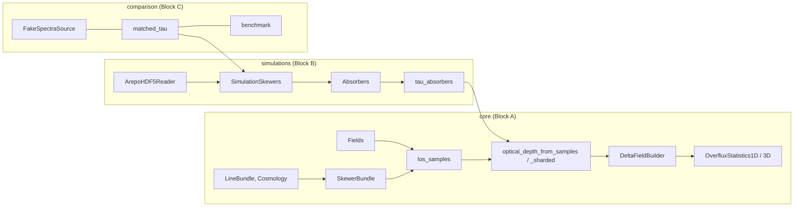

# Usage guide

This guide is the reference companion of the notebooks. It lists the entry points of each block, the conventions they
share and the options that control speed and memory. The notebooks (`notebooks/00`–`08`) show the same tools at
work, step by step.



Dependencies run one way only: `comparison` uses `simulations`, `simulations` uses `core`, and nothing in `core`
imports the other blocks. `skewerjax.utils.plotting` is outside the blocks.

## Conventions

- **Units.** Comoving Mpc for positions and path lengths, km/s for velocities, K for temperatures. Number densities are
  comoving cm⁻³ in `core.Fields` and physical cm⁻³ at the data epoch in `simulations.Absorbers`. Wavelengths are in Å.
- **Shapes.** τ is `(N_lines, N_skewers, N_v)`; a `SkewerBundle` holds `(N_cosmologies, N_skewers, N_points, 4)` events
  (a, x, y, z).
- **Frames.**
  - Each line is integrated in its own line-centred velocity frame v_†.
  - `wrap_to_ref_line` moves every line onto the reference line's frame, periodically (period N_v dv).
  - In simulations, `frame="exact"` uses a(x) along the path and `frame="snapshot"` uses fake_spectra's single
    redshift with a linear Hubble flow.
- **Precision.** SkewerJAX follows `jax_enable_x64` and never sets it. Every validated tolerance is a float64 one.
- **Purity.** Every container is a JAX pytree, and every kernel can be traced with `jit`, `vmap` and `grad`. The
  host-side parts are NumPy: snapshot I/O, the k-d tree selection, the deposition bookkeeping and fake_spectra.

## Block A: `skewerjax.core`

| task | entry point | main options |
|---|---|---|
| lines | `LineBundle(["HI-LyA", "SiIII-1206"], ref_line_id=...)` | any id of `core/lines_table.dat` (`LINES`) |
| background | `Cosmology(H0, Omega_r_0, Omega_m_0, Omega_k_0, Omega_lambda_0)` | batches of cosmologies; `solve_a_of_x(rtol, atol)` |
| skewers | `SkewerBundle(spatial_points, cosmologies, a0, x0, ...)` | `ICs_defined_at_index`, `ICs_at_emission_or_absorption`, `manual_scale_factors` |
| fields | `Fields({species: {name: ScalarField/VectorField}})` | samplers `LogRamp`, `VelocityRamp`, `Constant`, `GaussianDensity`, `SampledField` |
| τ | `compute_optical_depth(bundle, v, lines, fields, a_dagger=...)` | `voigt`, `detuning`, `velocity_period`, `v_chunk`, `batch_size`, `dtype`, `devices` |
| τ (layers) | `los_samples` → `optical_depth_from_samples` → `optical_depth_kernel` | `LoSSamples` is the boundary with Block B |
| frames | `wrap_to_ref_line`, `velocities_in_line_frames`, `line_wavelength_grid_A` | |
| overflux | `DeltaFieldBuilder(tau, labels=...).build()` | every line subset and the exact decomposition of the total |
| statistics | `OverfluxStatistics1D(ov, dv).compute_p1d().compute_xi1d()`, `OverfluxStatistics3D` | pairs, orders, binning (`bin_p1d`, `bin_p3d_kperp`) |
| metal models | `fit_mcdonald_a`, `fit_ma_model_profiled` | |

## Block B: `skewerjax.simulations`

```python
from skewerjax.core import LineBundle
from skewerjax.simulations import ArepoHDF5Reader, SimulationSkewers, ExtractionOptions, IntegrationOptions, HI

reader = ArepoHDF5Reader("/home/STORAGE/TNG50-4", 25)
sk = SimulationSkewers.axis_aligned(reader, [[17500.25, 17500.75, 0.0]], [3], spacing_kms=0.25)  # cofm in ckpc/h, axis z
v, tau = sk.optical_depth(LineBundle(["HI-LyA", "SiIII-1206"], ref_line_id="HI-LyA"))           # (2, 1, N_v)
```

- **Skewers:** `SimulationSkewers.axis_aligned` (straight, along a box axis) or `SimulationSkewers.from_bundle` (any
  `SkewerBundle`, with its own a(x)). The constructor selects the cells near the paths, streaming the snapshot in
  blocks of `max_rows` cells. Host memory is therefore set by the block size, not by the snapshot size.
- **Physics options** (`ExtractionOptions`): `deposition`, `mass_unit`, `T_constants`, `b_constants`, `x_HI_model`,
  `cloudy_density`, `cloudy_interpolation`.
- **Integration options** (`IntegrationOptions`): `frame`, `normalisation`, `detuning`, `periodic`, `dtype`.
- **Lower layers:** `sk.absorbers(ion)` gives the deposited pieces, `tau_absorbers(A, lines, v, frame)` the τ (options
  `chunk`, `v_chunk`, `dtype`, `devices`, `skewers`), and `sk.tau(...)` the τ cached in an HDF5 file when the object
  has a `name` and a `cache`.
- **Figure tools:**
  - `slab_projection(reader, normal_axis, centre, thickness, n_pix)` gives the gas surface density and the
    mass-weighted temperature of a slab;
  - `tau_by_path_bins(A, lines, v, frame, s_edges)` gives the τ made by each stretch of the path (notebook 07).

## Block C: `skewerjax.comparison`

- **Modes:** `FAKE_SPECTRA_EXTRACTION` + `FAKE_SPECTRA_INTEGRATION` reproduce fake_spectra (the matched mode), and
  `ExtractionOptions()` + `DEFAULT_INTEGRATION` are SkewerJAX's defaults. `matched_tau(sk, ion, lines, v, ext, integ)`
  evaluates any combination.
- **Effect chain:** `run_effects` and `effect_rows` switch one difference at a time (`EXTRACTION_EFFECTS`,
  `INTEGRATION_EFFECTS`).
- **fake_spectra itself:** `FakeSpectraSource(cache=DIR, snap_base=..., snapnum=...)` runs it live, in its own process
  (`python -m skewerjax.comparison.driver full ...`). `FakeSpectraSource(reference=FILE)` reads a file exported earlier
  with `FS.export(FILE)`.
- **Benchmark:** `comparison.benchmark` (`make_config`, `run_suite`, `load_results`, `summary`); see "Benchmarks" below.

## Speed and memory

| knob | where | effect |
|---|---|---|
| `v_chunk` | `optical_depth_from_samples`, `tau_absorbers` (default 4096) | velocities per kernel call: memory ∝ N_lines × N_points × v_chunk |
| `batch_size` | `optical_depth_from_samples` | skewers vmapped at once inside `lax.map` (more memory, fewer launches) |
| `chunk` | `tau_absorbers` (default 2048) | absorbers per row of the samples (a static shape: one compilation per row count) |
| `dtype="float32"` | `compute_optical_depth`, `tau_absorbers`, `IntegrationOptions` | opt-in: 2.4× faster on 16 TNG50-4 skewers on the CPU, max \|ΔF\| 1.6e-3 |
| `devices=` | `compute_optical_depth`, `tau_absorbers`, `optical_depth_sharded` | shards the skewer axis (or a skewer's absorber rows) over devices |
| `max_rows` | `SimulationSkewers` | cells per streamed block of the selection |

Sharding uses one call for any number of devices:

```python
import jax
from skewerjax.core import optical_depth_sharded
tau = optical_depth_sharded(samples, v, lines, devices=jax.devices())   # = optical_depth_from_samples(...) bit for bit
```

The skewers are padded to a multiple of the device count, and the padding is dropped from the result. On one device the
call falls back to `optical_depth_from_samples`. To try several devices on one CPU, start Python with
`XLA_FLAGS=--xla_force_host_platform_device_count=N`. This tests the code path only; XLA already uses all the cores of a
single CPU device.

## Validation, tests and benchmarks

```bash
python scripts/validation/run_all.py [--quick] [--skip tng,fake] [--outdir validation_output]
pytest                                                                  # tests/, CPU, seconds per test
SKEWERJAX_SLOW=1 pytest                                                 # also the TNG50-4 / fake_spectra checks
python scripts/benchmarks/benchmark_vs_fake_spectra.py --sets quick --results benchmark_results
```

The benchmark runs every configuration in its own process with its own CPU set and thread count. It skips the
configurations whose result already exists, and it caps each one at `--cap` seconds. The notebook
`08_benchmark_skewerjax_vs_fake_spectra` only reads the results (`RESULTS_DIR`).
