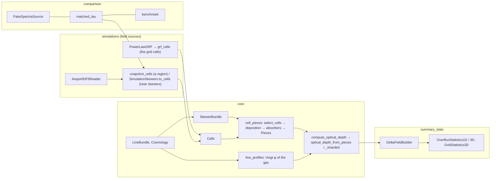

# Usage guide

This guide is the reference companion of the notebooks. It lists the entry points of each subpackage, the conventions they
share and the options that control speed and memory. The notebooks (`notebooks/00_quickstart`, `00_quickstart_step_by_step`, `01`–`12`) show
the same tools at work, step by step.



Dependencies run one way only: `comparison` uses `simulations`, `simulations` uses `summary_stats` and `core`,
`summary_stats` uses `core` only, and nothing in `core` imports the other subpackages. `simulations` holds every source of gas cells: the toy fields and the snapshots. `skewerjax.utils.plotting` is outside them.

## Conventions

- **Units.** Comoving Mpc for positions and path lengths, km/s for velocities, K for temperatures. Number densities are
  comoving cm⁻³ in `core.Cells`, `core.Absorbers` and `core.Pieces` (a snapshot's physical n_ion is multiplied by
  a_snap³ in `SimulationSkewers.to_cells`). Wavelengths are in Å.
- **Shapes.** τ is `(N_lines, N_skewers, N_v)`; a `SkewerBundle` holds `(N_cosmologies, N_skewers, N_points, 4)` events
  (a, x, y, z).
- **Cells.** Every source of gas is a set of Voronoi cells, `core.Cells`: generating points, volumes (size V^(1/3)),
  the periodic box and, per species, `number_density`, `temperature`, `velocity` (and optional `turbulence`,
  `collisional`). The field sources of `skewerjax.simulations` fill it: the toy fields (`grf_cells`: the cells of the
  grid, the Voronoi cells of its nodes, i.e. cubes centred on them) and the snapshots after their gas physics (`snapshot_cells`
  for a region of the box, `SimulationSkewers.to_cells` for the cells near a set of skewers).
- **Pieces.** τ is a sum over pieces, fragments of the path inside one cell (and one dual segment), each evaluated at
  its centroid (a, a⁻², the line centre) with its cell's values. `cell_pieces` (selection, deposition, absorbers) builds
  them for every source; they reach the kernel as `core.Pieces` through `compute_optical_depth`.
- **Periodicity** is one option of `compute_optical_depth`, `velocity_period`: `False` (default, the direct sum),
  `True` (each skewer periodic over its own velocity span, set by a at its first and last points) or a period in km/s.
  The detuning is then replaced by its nearest image; only that image is kept. `SimulationSkewers.tau`,
  `optical_depth` and `tau_absorbers` pass it through; nothing else wraps a spectrum.
- **Frames.**
  - Each line is integrated in its own line-centred velocity frame v_† (`line_frame="own"`, default), or directly on
    the reference line's axis (`line_frame="reference"`: line j at v + Δv_j).
  - `wrap_to_ref_line` shifts spectra computed in their own frames onto the reference axis by interpolation: without a
    period, τ is NaN where the shift leaves the grid; with `velocity_period=P` (a spectrum computed periodic on a grid of
    one period), it wraps modulo P.
  - In simulations, `frame="exact"` uses a(x) along the path and `frame="snapshot"` uses fake_spectra's single
    redshift with a linear Hubble flow.
- **Precision.** float32 by default, float64 on request (`skewerjax.config.set_precision("float64")`, which turns
  `jax_enable_x64` on): the device kernels follow the policy; the host geometry, a(s), the Hubble velocities of the line
  centres and the per-cell gas physics are float64 whatever it is. The audit and the float32 errors: `docs/precision.md`.
- **Purity.** Every container is a JAX pytree, and every kernel of the τ sum can be traced with `jit`, `vmap` and
  `grad`. The host-side parts are NumPy: snapshot I/O, the k-d tree selection, the deposition bookkeeping (so
  `cell_pieces` runs outside `jit`) and fake_spectra.

## `skewerjax.core`

| task | entry point | main options |
|---|---|---|
| lines | `LineBundle(["HI-LyA", "SiIII-1206"], ref_line_id=...)` | any id of `core/lines_table.dat` (`LINES`) |
| background | `Cosmology(H0, Omega_r_0, Omega_m_0, Omega_k_0, Omega_lambda_0)` | batches of cosmologies; `solve_a_of_x(rtol, atol)` |
| skewers | `SkewerBundle(spatial_points, cosmologies, a0, x0, ...)` | `ICs_defined_at_index`, `ICs_at_emission_or_absorption`, `manual_scale_factors` |
| gas cells | `Cells(positions, volumes, species, box)`, `cells_from_values`, `cells_on_grid`, `grid_points`, `voronoi_volumes` | (filled by the sources of `skewerjax.simulations`) |
| line profiles | `core.line_profiles`: `line_profiles(v, lines, temperature=..., los_velocity=..., scale_factor=..., a_dagger=...)`, `voigt_line_profiles`, `voigt_widths_GHz`, `voigt_width_kms` | `voigt` (`PROFILE_MODES`: `"ExoJAX"`, `"harris"`: first order in the damping parameter, a ≤ 10⁻³, exact above; any other mode raises), `detuning` (`"exact"`, `"linear"`), `velocity_period` |
| Voigt function | `core.voigt`: `voigt_exojax`, `voigt_harris`, `voigt_convolution` (FFT on an increasing uniform grid), `voigt_scipy` (wofz, NumPy), `log10_voigt(mode=)` | standalone; the line profiles and τ use ExoJAX or Harris |
| τ | `compute_optical_depth(bundle, v, lines, cells, a_dagger=...)` or `compute_optical_depth(pieces, v, lines)` | `deposition` (`"voronoi"` default, `"tophat"`, `"tophat_chords"`, `"voronoi_crossings"`), `line_frame`, `velocity_period`, `a_eff` (None: a_p^-2 of every piece; a scalar: a_eff^-2 for all, the line centres and detuning untouched), `hubble_flow` (`"exact"` default: V_H = c ln(a†/a(y)); `"linear"`: V_H(0) + (aH)_ref y, fake_spectra; the period of `velocity_period=True` and the resolution widths follow it; `velocity_span(pieces \| bundle \| frame, hubble_flow, aH_ref)`), `aH_ref` (None: the frame's aH at the first point, `Pieces.aH_first`; traced, differentiable), `voigt`, `detuning`, `b_constants`, `pixel_average`, `tautail` (fake_spectra's per-cell schemes, section below), `resolution_tolerance`, `v_chunk`, `piece_chunk`, `batch_size`, `per_piece`, `dtype`, `devices`, `return_info` |
| debugging | `check_skewers(cells, bundle, lines)`, `enable_logging()`, `return_info=True` | see "Debugging and input checks" |
| τ (layers) | `select_cells` → `voronoi_segments` / `grid_segments` / `tophat_segments` / `tophat_chord_segments` → `absorbers_from_components` → `absorber_pieces` (all in `cell_pieces`) → `Pieces` → `optical_depth_from_pieces` → `optical_depth_kernel` | `resolution_report(pieces, lines)`; `voronoi_segments(..., backend="jax")`; `tau_absorbers`, `tau_by_path_bins` |
| frames | `compute_optical_depth(..., line_frame="reference")`, `wrap_to_ref_line`, `velocities_in_line_frames`, `line_wavelength_grid_A` | |

## `skewerjax.summary_stats`

The overflux and its statistics (imports `core` at most). Modules: `overflux`, `orders` (the order-by-order
decomposition), `stats_1d`, `stats_3d`, `grid3d`, `fourier` and `binning` (shared conventions and binning),
`contaminants`, `field_stats` (the density of gas cells through a mesh, any source), `mesh` (points on a mesh: mass
assignment, interlacing, the window) and `density` (the density along a lattice of skewers); every
entry point below is also importable from `skewerjax.summary_stats`. Arrays, geometry and `core.Cells` only: nothing from
`skewerjax.simulations` enters (an expectation is a callable P(k)). Any number of lines: the overflux of every line,
every subset product and the orders 0 .. 2 N_lines.

| task | entry point | main options |
|---|---|---|
| overflux | `DeltaFieldBuilder(tau, labels=..., mean="redshift", grid=None, mean_transmission=None).build()` (`overflux`), `overflux_terms`, `mean_transmissions(T, mean, grid=)`, `ensemble_mean_transmissions(T, mean, grid=)` (an ensemble of boxes (n, N_lines, N_s, N_pix): T̄ as a broadcast view (n, N_lines + 1, N_s, N_pix), so δ = T / T̄ − 1 elementwise in every mode), `overflux_check(delta, T_bar, mean, grid=)` (⟨δ⟩ over the sets of the mode, C, \|C − ⟨δ₁δ₂⟩\|, the decomposition), `check_shared_grid`, `redshift_groups(grid)` (the pixels at the same scale factor), `MEAN_MODES`, `equivalent_width_kms` | δ = T / T̄ − 1 with T = e^−τ the transmission and T̄ its mean over a set of pixels (the samples, or `mean_transmission` for an ensemble split over several arrays): `mean="redshift"` (default) T̄(z), the samples at each pixel on one shared grid of scale factors (`grid` checked, `ValueError` if the samples differ; pixels at the same scale factor share one mean, so on one snapshot T̄(z) is the global mean), removing the mean-flux evolution along the path; `"global"` one number over every pixel of every sample (a drift of the mean along v stays); `"box"` one number per box (= "global" on one array; an ensemble of boxes distinguishes them); `"skewer"` one number per sample (removes k∥ = 0 of every skewer, like continuum fitting); ⟨δ⟩ = 0 over the set of the mode; every line subset and the exact decomposition of the total with C = T̄ / Π T̄_j − 1 = Σ_{\|A\|≥2}⟨δ_A⟩ over the same set |
| order by order | `orders`: `ZERO_ORDER_KEY` (the order-0 term), `subset_orders`, `order_sum` | |
| 1D statistics | `skewer_p1d(delta, dv)`, `skewer_xi1d(delta, dv)` (`lattice`: one 1D FFT per skewer, averaged over the skewers; every mode, every lag 0 .. N/2); `OverfluxStatistics1D(ov, dv).compute_p1d().compute_xi1d()` (`.summary()`: one record of NumPy arrays), `decompose_1d(tau, dv, T_bar, mean=)` (the opt-in order-by-order decomposition of one set of skewers), `ensemble_1d(summaries)` (mean, error of the mean, every realisation), `p1d_from_tau` (`stats_1d`) | pairs, orders, binning (`bin_p1d`) |
| 3D statistics on a lattice of skewers | `lattice_grid(n_x, n_z, n_los, L, d_perp, k_edges=, r_edges=, rperp_edges=)`, `measure_lattice(delta, grid)`, `on_lattice`, `lattice_limits(L, d_perp, n_los, period)` (`lattice`: arrays and geometry only) | the line of sight in comoving units through u = period / L; bins beyond the full coverage cut |
| 3D statistics by term | `OverfluxStatistics3D(ov, dv, d_perp)` (`stats_3d`) | pairs, orders, binning (`bin_p3d_kperp`) |
| the 3D estimator | `GridStatistics3D(shape, L, los_axis=1)` (`grid3d`): `.measure(delta)` (a field sampled on the grid's lattice: the skewer samples, the lattice path), `.measure_points(positions, values, mas=, interlace=, shot_noise=, chunk=)` (a field at points, through a mesh), `.theory(P_on_modes)` (the exact expectation, binned alike), `.xi_iso_covariance(P_on_modes)` (the exact Gaussian covariance of the isotropic ξ bins), `.axes()`; `ensemble_mean(records, GRID_KEYS)` (`binning`) | without the k = 0 mode (ξ of the field minus its box mean); P and ξ isotropic, in the (∥, ⊥) plane and in wedges of μ (`MU_WEDGES`, DESI DR2); bin edges (`hybrid_k_edges`, `bao_k_edges(k_f, k_max, k_w, k_1=, dk_factor=0.25, n_log=)`, `native_edges`, `full_coverage`, `occupied_edges`, `binning`); `multipoles=True` |
| the field statistics of gas cells (one path for every source) | `box_grid(n_cells, L, k_edges=, r_edges=)` (`GridStatistics3D` of the mesh with the map rows on its own modes and separations; bins beyond `grid_limits(n_cells, L)` cut), `field_statistics(cells, grid, species=, mas="pcs", interlace=True, power=, power_nw=, chunk=)` (`field_stats`: one `core.Cells` or an iterable of them, streamed: every cell deposits n_X V at its generating point (`cell_weights`), the mesh normalised by its mean, deconvolved and interlaced; toy grids (`ToyBoxes.cells`, `grf_cells`) and snapshots (`gas_to_cells`) alike; `species` a key or a list ({species: result}); returns the ensemble mean, `theory`, `cov_xi_iso`, `axes`, `limits`, `trusted` (k < k_Nyq / 2, r ≥ 6 H), `mas`, `interlace`, `n_mesh`, `k_nyq`), `grid_power(power, shape, L)`, `xi_chi2(res)`, `xi_subset_offsets(res)`, `bao_height(r, r2xi, r_bao, sigma_bao, err=)`; `core.redshift_space_cells(cells, axis, aH)` (the generating points moved by v / (aH) along an axis, wrapped) | `power`, `power_nw`: callables P(k) of \|k\| (e.g. `PowerLawGRF.power`): the expectation (the spectrum of the field on the mesh modes), the exact covariance of ξ, the expectation without the bump; for fields given at the mesh nodes (a toy grid of the mesh's shape) the exact mean through the mesh is `mesh.node_transfer` × P (bias 3e-4 at k_Nyq / 2, 2e-2 at k_Nyq for interlaced PCS) |
| theory helpers | `integral_constraint(xi, L)` (`theory`: the mean of ξ over the box, the term of the k = 0 mode, with the exact area of the sphere inside the cube, `sphere_area_in_cube`), `bao_maxima(k_max, window=, r_bao=, k_min=, kms_per_cMpc=)`; `pair_imprint(separation, k_max, kind="p1d" | "iso", period=, n_harmonics=, k_min=)` (the maxima in k of the cross term of two lines, k = 2πn/Δ in P1D and the maxima of j₀(kΔ) in P(|k|), the separation folded) (the positive maxima of the bump term W(k), or of j₀(k r_d)), `xi_corner(res, grid=, power=)` (`field_stats`: the corner r∥ ≈ L/2, r⊥ ≈ 0 of the map and its error; `GridStatistics3D.xi_map_sigma`: the exact Gaussian error of a combination of the map's cells) | |
| points on a mesh | `paint(positions, weights, n_mesh, L, mas="pcs", shift=0.0, chunk=2**21)` (periodic deposition in 1D, 2D, 3D, chunked), `mas_window(k, H, mas)` (W(k) = Π [sin(k_i H/2)/(k_i H/2)]^p), `fourier_mesh(positions, weights, n_mesh, L, mas="pcs", interlace=True, deconvolve=True, chunk=)` (rfft of the mesh, interlaced with the mesh shifted by H/2, divided by W; returns (F, meta)), `aliased_power(power, n_mesh, L, mas=, interlace=)` (the expectation for points at random positions: the alias sum), `node_transfer(n_mesh, L, mas=, interlace=)` (the exact transfer for points at the nodes) (`mesh`; Sefusatti et al. 2016) | `mas`: "ngp", "cic", "tsc", "pcs" (default) (B-spline orders 1–4); `interlace` cancels the alias images with odd n_x + n_y + n_z; jitted, `n_mesh` and `mas` static; differentiable in the weights (and the positions for p ≥ 2). The statistics of skewer samples (`GridStatistics3D.measure`, `measure_lattice`, `skewer_density_statistics`, `skewer_p1d`, `skewer_xi1d`, `decompose_1d`) stay on their own lattice, along the line of sight N_pix pixels or n_cells p points, across it the skewer spacing, and refuse `mas` and `interlace` (`mesh.lattice_only`); the exact grid FFT of a field is kept in the tests only, as the validation reference of the mesh |
| density along skewers | `skewer_density_statistics(columns, points_per_cell, grid, L, n_bar=)` (`density`: every species and their sum at the points of the skewers, `on_points`, against their global mean; the 3D estimator on `lattice_grid` of the points and the 1D statistics), `lattice_density_theory(power, grid, n_cells, stride, points_per_cell=, p1d=, scale=)` (its exact expectation on that lattice: ξ_grid at the lattice separations, the aliased P) | `scale` = `density_scale` (the global-mean normalisation) |
| metal models | `fit_mcdonald_a`, `fit_ma_model_profiled`, `mcdonald_factor`, `ma_factor` (`contaminants`) | |

## The paths (`skewerjax.core.skewers`)

A regular lattice of straight skewers along y through the centres of the cell columns of an N³ grid, as the points of a
`core.SkewerBundle` (all importable from `skewerjax.core`).

| task | entry point | main options |
|---|---|---|
| lattice of skewers | `lattice_columns(n_cells, stride)` ((N_sk, 2) node indices, x-major), `lattice_points(columns, dx, L, n_cells, points_per_cell)` ((N_sk, N p + 1, 3) points from y = 0 to y = L), then `SkewerBundle(spatial_points=..., cosmologies=..., a0=1 / (1 + z), x0=0.0, ICs_defined_at_index=0)` (the exact frame, z at y = 0) | `stride`, `points_per_cell`; the 3D statistics need N to be a multiple of both strides |
| frame | `hubble_velocity(bundle)` (c ln(a0 / a) along the first skewer), `core.velocity_span(bundle, hubble_flow)` (the period), `core.bundle_frame` | |

## `skewerjax.simulations`

**Toy fields.**

| task | entry point | main options |
|---|---|---|
| Gaussian random field | `PowerLawGRF(A_s, k_0, n_s, L=..., N=...)` (or `k_min`, `k_max`, `N_k`); `sample(key)`, `power(k, mu, bao=True)`, `power_grid(bao=True)` (`bao=False`: the power law alone), `power_at(*k_components)`, `power_monopole(k)`, `variance()`, `correlation(r)` (the continuous ξ(r) of an isotropic 3D spectrum in closed form, power law + bump, for −2 < n_s < 0; outside it one line and the numerical transform over the grid's k range), `correlation_hankel(r, k_range=None, k_tail=40)` (the numerical Hankel transform), `bao_window(k)`, `bao_power(k)`, `bao_ratio_max()` | optional, off by default: `beta` (Kaiser (1 + beta mu^2)^2), `sigma_fog`, `fog` (`"lorentzian"`, `"gaussian"`), `A_bao`, `r_bao`, `sigma_bao` (a Gaussian bump in xi; P = P_pl + A_bao W with W its exact transform in 1D/2D/3D, which changes sign: valid, P >= 0 at every mode, for A_bao / A_s <= R_max = min over the grid modes with W < 0 of (k/k_0)^(n_s−1) / \|W\|, `bao_ratio_max()`; a larger ratio raises); `los_axis` (default: the last axis) |
| toy gas cells | `grf_cells(delta, grf, n_bar, ...)` | the cells of the grid (cubes centred on the nodes); `temperature` / `velocity` (and `turbulence`, `collisional`) as scalars, arrays on the grid or functions of the nodes |
| toy boxes (08, 10) | `ToyBoxes(box_cMpc, velocity="zero" \| "linear")` (`bao_ratio` at most `bao_ratio_max`, else an error quoting it): realisation i from the seed `base_seed + i` (`delta(i)`, `fields(i)`, `cells(i)`, never stored); `grf()` (its `PowerLawGRF`: `grf().power` is the expectation passed to `summary_stats.field_statistics` and `lattice_density_theory`), `cosmology()`, `aH`, `dx`, `species`, `n_bar`; `metal_to_hi` (one ratio n_X / n_HI per metal species, default `METAL_TO_HI` = {SiIII: 0.2, SiII: 0.1}: Si II a toy choice, half of Si III); `LINE_IDS` (the default lines: Lyα, Si III 1206, Si II 1193, Si II 1190). The gas only: the skewers through the boxes are `core.lattice_points` and their statistics `skewerjax.summary_stats` (notebooks 08 and 10 compose them) | power law + BAO, isotropic, `sigma_delta`; n_X = r_X n_HI, T_gas = T0 (1 + δ)^(γ−1), zero velocities (default) or linear theory (`f_growth`); recomputed at every call, nothing stored |

**Snapshots.**

```python
from skewerjax.core import LineBundle
from skewerjax.simulations import ArepoHDF5Reader, SimulationSkewers, ExtractionOptions, IntegrationOptions, HI

reader = ArepoHDF5Reader("/home/STORAGE/TNG50-4", 25)
sk = SimulationSkewers.axis_aligned(reader, [[17500.25, 17500.75, 0.0]], [3], spacing_kms=0.25)  # cofm in ckpc/h, axis z
v, tau = sk.optical_depth(LineBundle(["HI-LyA", "SiIII-1206"], ref_line_id="HI-LyA"))  # (2, 1, N_v)
```

- **Skewers:** `SimulationSkewers.axis_aligned` (straight, along a box axis) or `SimulationSkewers.from_bundle` (any
  `SkewerBundle`, with its own a(x)). The constructor selects the cells near the paths, streaming the snapshot in
  blocks of `max_rows` cells. Host memory is therefore set by the block size, not by the snapshot size.
- **Physics options** (`ExtractionOptions`): `deposition` (`"voronoi"` default, `"tophat"`, or the opt-in
  `"voronoi_crossings"`: one absorber per sub-piece of each cell crossing, split so that its velocity width stays below
  0.25 b), `mass_unit`, `T_constants`, `x_HI_model`, `cloudy_density`, `cloudy_interpolation`.
- **Selection:** `selection.select_cells_near_paths(reader, points, workers=-1)` reads the snapshot through memory maps
  with one thread per block of every file, keeps the candidates of a grid of distance bounds to the paths and applies the
  exact rule (periodic `cKDTree`) to them; `core.select_cells` applies the same rule to cells in memory.
- **Cells without skewers:** `snapshot_cells(reader, species, lo, hi, margin=...)` gives the cells of a periodic
  sub-box as `core.Cells` (`select_cells_in_region`, then `gas_to_cells`); the margin keeps every cell whose generating
  point can be the nearest to a point of the region. Cost on TNG50-4: one pass over the positions (about 1 s with a
  warm file cache) plus the gas physics of the kept cells.
- **Cells near skewers:** `sk.to_cells(species)` gives the selected cells as `core.Cells` (per ion: n_ion a_snap³, T,
  the peculiar velocity), the container of the toy fields, with the values of `snapshot_cells` for the same cells. The deposition is the core's (`core.deposition`; `voronoi_segments(...,
  backend="jax")` computes the same pieces in JAX). `SimulationSkewers.crossings()` keeps the cell crossings of the
  skewers alongside their points (`CellCrossings`).
- **Integration options** (`IntegrationOptions`): `frame`, `b_constants`, `detuning`, `dtype`, `a_eff` (None: a_p^-2 per piece; a scalar: one comoving-to-physical conversion a_eff^-2, e.g. `header.a`). Periodicity is not one
  of them: `sk.tau(..., velocity_period=...)` and `sk.optical_depth(..., velocity_period=..., line_frame=...)` pass the
  core's option through (default: none). `spectral_grid(res, frame)` spans the velocity span of the box and implies no
  wrap.
- **Lower layers:** `sk.absorbers(ion)` gives the deposited pieces (`core.Absorbers`), `sk.pieces(ion, lines)` the same
  as `core.Pieces` (through `core.cell_pieces`, for `compute_optical_depth`), `core.tau_absorbers(A, lines, v, frame)`
  the τ (options `velocity_period`, `chunk`, `v_chunk`, `dtype`, `devices`, `skewers`), and `sk.tau(...)` the τ of one
  line, computed on every call. Cells already in memory (a region from `snapshot_cells`,
  a toy model) are selected with `core.select_cells`, the same rule as the streamed `select_cells_near_paths`.
- **Figure tools:**
  - `slab_projection(reader, normal_axis, centre, thickness, n_pix)` gives the gas surface density and the
    mass-weighted temperature of a slab;
  - `voronoi_slice(cells, species, normal_axis, centre, n_pix)` the section of the Voronoi cells by a plane: the
    density of the cell each pixel centre lies in (notebook 11, C1);
  - `core.tau_by_path_bins(A, lines, v, frame, s_edges)` gives the τ made by each stretch of the path
    (`00_quickstart_step_by_step`).

## fake_spectra's choices, one option each

SkewerJAX re-implements nothing of fake_spectra: every difference is one option of the function it belongs to, whose
default is SkewerJAX's choice and whose alternative is fake_spectra's. Notebook 12 runs fake_spectra natively (environment
`skewerjax-fs`, `docs/installation.md`), shows the fully matched mode and tests each option on its own, from both ends.

| function | keyword: default → fake_spectra | fake_spectra |
|---|---|---|
| `simulations.gas_to_cells` | `T_constants`: `"codata"` → `"fake_spectra"` | `unitsystem.py` L21, L23 |
| | `mass_unit`: `"amu"` → `"proton"` | `gas_properties.py` L108, `absorption.h` L4 |
| | `x_HI_model`: `"stored_sf"` → `"fake_sf"` (its `sf_neutral=True`) | `gas_properties.py` L116–L146 |
| | `cloudy_density`: `"hydrogen"` → `"fake_spectra"` (0.774 ρ/m_p) | `spectra.py` L691–L698, `convert_cloudy.py` L183 |
| | `cloudy_interpolation`: `"linear"` → `"cubic"` | `convert_cloudy.py` L199 |
| `core.cell_pieces` | `deposition`: `"voronoi"` → `"tophat"` (spheres of radius V^(1/3)) | `absorption.cpp` L112–L118 |
| | `deposition`: → `"tophat_chords"` (7 points per chord, straight paths) | `singleabs.h` L100–L118 |
| | `chord_weight`: `None` (1/7) → `1/8` (7/8 of the column) | `singleabs.h` L97–L100, L116 |
| | `frame`: `bundle_frame` → `SnapshotFrame` (one a, u = aHs + v_pec) | `absorption.cpp` L237 |
| `core.compute_optical_depth` | `b_constants`: `"codata"` → `"fake_spectra"` | `absorption.cpp` L24, L158 |
| | `voigt`: `"harris"` (the default) is fake_spectra's below a = 1e-3; above, fake_spectra's exact Faddeeva against SkewerJAX's fourth order (5e-7) | `singleabs.h` L57–L66, `fastvoigt.h` |
| | `velocity_period`: `False` → the span of the grid | `absorption.cpp` L261–L264 |
| | `a_eff`: `None` → `a_snap` | `spectra.py` L221, L615 |
| | `hubble_flow`, `aH_ref`: `"exact"` → `"linear"`, (aH)_snap | `absorption.cpp` L237, `spectra.py` L225–L228 |
| | `detuning`: `"exact"` → `"linear"` | `singleabs.h` L182 |
| | `pixel_average`: `False` → `True` (needs a uniform grid; eager) | `singleabs.h` L133–L155 |
| | `tautail`: `None` → `1e-7` (per cell, needs `Pieces.cell`; eager) | `absorption.cpp` L253–L281, `spectra.py` L145 |

`core.density_per_pixel(absorbers, L, nbins)` is the number density in position pixels, fake_spectra's `get_density`.

## `skewerjax.comparison`

**Benchmark:** `comparison.benchmark` (`PRESETS`, `benchmark_sets(name, data_dir, preset=)`, `make_config`,
`run_suite(total_budget_s=)`, `collect`, `result_rows`, `print_rows`; `RunClock`, `StageTimer`: notebook 13) and
`comparison.scaling` (`scaling_points`, `run_points`, `run_point`, `load_records`: notebook 14); see "Validation, tests
and benchmarks" below.

## Speed and memory

| knob | where | effect |
|---|---|---|
| `v_chunk` | `compute_optical_depth`, `optical_depth_from_pieces`, `tau_absorbers` (default 4096) | velocities per kernel call: memory ∝ N_lines × N_pieces × v_chunk |
| `batch_size` | `compute_optical_depth`, `optical_depth_from_pieces` | skewers vmapped at once inside `lax.map` (more memory, fewer launches) |
| `piece_chunk` / `chunk` | `compute_optical_depth` / `tau_absorbers` (default 2048) | pieces per kernel call: each skewer's pieces summed in rows (`Pieces.rows`; a static shape) |
| `dtype=` | `compute_optical_depth`, `tau_absorbers`, `IntegrationOptions` | the precision of the sum (None: the policy, float32 by default; `"float64"` for validation) |
| `devices=` | `compute_optical_depth`, `tau_absorbers`, `optical_depth_sharded` | `skewerjax.config.devices("cpu" \| "gpu")`: the sum over pieces shards the skewers, the per-cell schemes dispatch their chunks; one device: run there |
| `max_rows` | `SimulationSkewers` | cells per streamed block of the selection |
| `deposition="voronoi_crossings"` | `ExtractionOptions` | one absorber per (sub-piece of a) cell crossing instead of per piece of every dual segment: ~10× fewer H I absorbers at 0.25 km/s spacing, independent of the spacing |

Sharding uses one call for any number of devices:

```python
import jax
from skewerjax.core import optical_depth_sharded

tau = optical_depth_sharded(pieces, v, lines, devices=jax.devices())  # = optical_depth_from_pieces(...) bit for bit
```

The skewers are padded to a multiple of the device count, and the padding is dropped from the result. On one device the
call falls back to `optical_depth_from_pieces`. To try several devices on one CPU, start Python with
`XLA_FLAGS=--xla_force_host_platform_device_count=N`. This tests the code path only; XLA already uses all the cores of a
single CPU device.

## Debugging and input checks

**Input checks.** The entry points check their inputs eagerly and raise a `ValueError` that names the field and its
first bad entry. They are skipped for traced values, so `jit`, `vmap` and `grad` are unaffected:

- `Cells`: positions, velocities and densities must be finite, volumes > 0, and temperatures, turbulence and collisional
  terms ≥ 0. Negative densities are allowed (`grf_cells` warns about them).
- `SkewerBundle`: points must be finite, with at least 2 per skewer, and `a0` > 0. `manual_scale_factors` must have
  shape (N_cosmologies, N_sk, N_ppsk), and a(x) must stay finite and > 0 along every path.
- `Cosmology`: the parameters must be finite, with H0 > 0. `LineBundle` needs at least one known line.
- `select_cells`: when no cell is within reach, the error gives the closest cell's distance and selection radius.
  The streamed version gives a hint about the units.
- `cell_pieces`: the paths must have the right shape, the deposition must exist, the cells must hold every species,
  and the segments must match the points.
- `compute_optical_depth` checks:
  - `line_frame`, `voigt` and `detuning`;
  - that the chunk sizes are positive integers, and the shape and finiteness of the velocity grid;
  - `velocity_period`;
  - the shapes and values of the pieces (`check_pieces`).

  The resolution check (`resolution_tolerance`) warns when the pieces are too wide in velocity for the line widths.

**Diagnostics** (all off by default; when off they cost nothing):

```python
from skewerjax.core import check_skewers, compute_optical_depth, enable_logging

report = check_skewers(cells, bundle, lines)  # when a result looks wrong
print(report)  # coverage, column, window, resolution: ok / FAILED, with numbers
tau, info = compute_optical_depth(bundle, v, lines, cells, return_info=True)
enable_logging()  # the package's log messages (logger "skewerjax") on stderr
```

- `check_skewers(cells, bundle, lines)` returns a `SkewerCheck` (`report.ok`, `report.checks[name]`), with four
  independent checks:
  1. the pieces tile every path (Σ l_p = path length);
  2. the column Σ n_p l_p of every species matches a fine sampling of the path. Each sample takes the nearest
     generating point among *all* the cells, so a selection or deposition that misses cells fails, and the missing
     cells are listed;
  3. over one period with `velocity_period=True`, ∫ τ dv equals the value from the pieces, Σ C f n_p a_p⁻² l_p λ;
  4. the resolution report.
- `return_info=True` on `select_cells`, `simulations.select_cells_near_paths`, `deposit`, `cell_pieces` and
  `compute_optical_depth` returns an extra dict:
  - counts (cells, candidates, selected, pieces);
  - path and piece lengths, and the columns per species;
  - the resolution ratios and the time of every stage;
  - for τ, the window fraction: ∫ τ dv over the grid divided by its value from the pieces.

  With `return_parts`, `cell_pieces` returns (pieces, parts, info).
- Logging: every module logs through `logging.getLogger("skewerjax.<module>")`, at DEBUG level, with counts and times
  per stage. The package's logger has a `NullHandler`, so it stays silent unless configured, for example with
  `enable_logging(logging.DEBUG)`.

## Validation, tests and benchmarks

```bash
pytest                                                                  # the fast default (-m "not slow"); tests/README.md
pytest -m "slow or not slow"                                            # every test; markers: slow, tng, gpu, fake_spectra
python scripts/dev/update_regression_references.py                     # only for an intended change of the results
python scripts/dev/check_markdown_math.py notebooks/*.ipynb             # the notebooks' markdown math (MathJax)
python scripts/checks/check_install.py; python scripts/checks/check_toy.py; python scripts/checks/check_tng.py   # the basic checks
python scripts/benchmarks/benchmark_fake_spectra.py [--preset quick|full] [--sets scaling,threads]   # SkewerJAX vs fake_spectra (quick <= 30 min, full ~10 h; --sets smoke ~4 min)
python scripts/benchmarks/benchmark_scaling.py [--blocks A,B,C1,C2] [--list]                         # the scaling of notebook 14, one record per point (resumable)
```

The suite (`tests/`) mirrors the package: `core/` (one module per area; `test_optical_depth.py` for τ),
`simulations/`, `utils/`, `comparison/` and `regression/` (every result against `tests/regression/data/*.npz`). The
physics checks (closed forms of τ, Voigt limits, a(x), statistics recovery, jit / vmap of every kernel, the TNG50-4
field extraction and τ, the comparison with fake_spectra) are tests with markers.

The benchmark (`comparison.benchmark`, launched by `scripts/benchmarks/benchmark_fake_spectra.py`) runs every
configuration (code, snapshot, number of skewers, device, threads) in its own process, pinned to a fixed CPU set with
fixed OpenMP / BLAS / XLA threads and `XLA_PYTHON_CLIENT_PREALLOCATE=false`. Each process runs once (the first run: JIT
compilation, cold page cache) and then up to three timed runs; the stages (I/O, cell selection, gas physics, pieces, τ)
are exclusive wall times, and SkewerJAX's matched and default modes share one selection. The launcher stops a worker at
`--cap` seconds or when its memory passes `--mem-cap` / the machine's free memory falls below `--mem-floor`, skips the
larger skewer counts of a series that hit (or is predicted to hit) a limit, and keeps the records that exist, so an
interrupted run resumes. Two presets (`benchmark.PRESETS`): `quick` (the default; TNG50-3 and TNG50-2 at small N and
the threads at N = 1, one or two timed runs, a cap and an estimate per point, and no point started once the time spent
plus its estimate would exceed `--budget`, 1800 s) and `full` (N up to 1024 on the three snapshots, the threads at
N = 16; it re-measures the quick points that hold fewer timed runs). Every record keeps its preset. The raw records go to
`benchmarks/raw/fake_spectra` (git-ignored), and their summary to `benchmarks/results/fake_spectra_benchmark.json`
(committed; with the runtime per preset and the list of launches), which `15_comparison_fake_spectra_benchmark` plots (`RUN_BENCHMARKS = True` re-runs the missing
configurations of its `PRESET`).

The scaling benchmark (`comparison.scaling`, launched by `scripts/benchmarks/benchmark_scaling.py`, plotted by
`14_comparison_fake_spectra_scaling`) runs the four entries of notebook 13 (fake_spectra; SkewerJAX default and matched on
the CPU, default on the GPU) on nested grids of skewers along y, with notebook 13's calls: block A the simulation
(TNG50-4, -3, -2), B the number of skewers (4² to `N_MAX`²), C1 the pixel width, C2 the sampling along the skewer. Each
point runs in its own process (32 OpenMP threads, float32, the GPU next to the CPU), SkewerJAX in batches of skewers
with a warm-up batch and one timed run, and writes `benchmarks/results/scaling/<id>.json`: the stage times, the JIT time,
the page-cache state, the machine, the agreement over all skewers and the flux of the reference skewer (L/4, L/4).

## Figures: `skewerjax.utils.plotting`

One call at the top of a notebook or script applies the style of every figure:

```python
from skewerjax.utils.plotting import use_style, use_backend

use_backend()  # interactive figures (ipympl, "%matplotlib widget") in a live notebook; inline when headless
use_style()  # "paper" (default): white background, publication look, Paul Tol's colour-blind-safe "bright" scheme
use_style("dark")  # black background, NeonGlow under every line (the same colours, in the same order)
from skewerjax.utils.plotting import ENTITY_COLORS as EC, PALETTE, CMAPS, FG, BG, DIM, LABELS  # FG, BG, DIM follow the style
```

- Only the background, the foreground (`FG`, `BG`, `DIM`, `ENTITY_COLORS["total"]`) and the direction of the
  sequential maps (`CMAPS["sequential"]`, `"hot"`, `"line"`, `"density"`: low values merge with the background) change
  between the two styles. Import `FG`, `BG` after `use_style`. `CMAPS["density"]` (Tol's smooth rainbow, whole range)
  colours the cell densities of `plot_gas_cells` and of the deposition figures, so that neighbouring cells stay distinct.

- Colours: every discrete colour is Tol's "bright" scheme (`PALETTE` = `tol_colors.colorsets["bright"]`, vendored with
  identical values when `tol_colors` is not installed), in Tol's order (blue, red, green, yellow, cyan, purple, grey).
  `ENTITY_COLORS` fixes the colour of every line and quantity in every notebook (Lyα blue, Si III red, density green,
  temperature purple, velocity yellow, ...). Continuous maps are Tol's (`CMAPS`, registered as `tol_<name>[_r]`).
- Text: minimum font sizes `FONT_MIN` (ticks 16, labels 20, legends / annotations / text boxes 15, floor 13);
  `check_fonts(fig)` lists any text below the floor.
- `SKEWERJAX_HEADLESS=1` forces the inline backend (e.g. when executing notebooks with nbconvert).

- Line styles per mode: `MODE_STYLES`; labels with units: `LABELS`; sizes: `FIGSIZES`.
- `plot_dag(highlight, external=False)`: the dependency graph of the ingredients, from the one specification
  `skewerjax.utils.dag` (`DAG_NODES`: name, module, realm, key functions; `DAG_EDGES`: every edge a dependency of the
  code, with the functions that implement it and the array it carries; `DAG_NOTEBOOKS`; `LAYERS`), drawn over the bands
  of the realms with the module under every name. The same specification gives the README's Mermaid diagrams, tree
  and table (`dag_to_mermaid("pipeline" | "layers")`, `module_tree`, `concept_table`; written by
  `scripts/dev/make_diagrams.py`, checked by `tests/utils/test_dag.py`).
- Path geometry: `geometry_style(name)`, the one style of points, midpoints, dual segments, tangents, line elements,
  piece ends and generators (03).
- Helpers: `add_panel_letters(axes, labels=None, box=True)` ((a), (b), ... or any labels such as "a1", "a2").
- Tutorial figures: `plot_toy_box` (00), `plot_slab_and_skewer`, `plot_cell_crossings`, `plot_voigt_of_piece`,
  `plot_tau_stretches`, `plot_wrap_tiles`, `plot_overflux_p1d_xi` (00b), `plot_grf_draws` (04), `plot_line_table`,
  `plot_scale_factor_solutions`, `plot_skewer_geometry_3d`,
  the toy boxes of 08 and 10, the cells of TNG50-4 (09) and the TNG50-4 skewers of 11 (from `summary_stats.field_statistics`, the lattice statistics and `skewer_density_statistics`; no titles; maps with the line of sight
  vertical, three iso-contour levels, the measured ones green with their ±1σ band, white μ-wedge rays with coloured
  sectors): `plot_toy_fields` (A2),
  `plot_isotropic_recovery(res, quantity="r2xi", r_bao=, k_edges=, r_edges=, k_marks=, r_marks=, k_scale=, r_scale=, x_bin=, each_label=, bao_k=)` (P and r²ξ, shaded outside the full coverage with the limits written inside; with `grf` the continuous ξ and ξ − ξ̄_V (`integral_constraint`); `bao_k`: the BAO maxima (`bao_maxima`), thin lines in the P panels; without an expectation, the measurement alone, one row), `plot_kpar_kperp_maps(res, kperp_edges=, levels=, cmap=, k_marks=, kpar_scale=, kperp_scale=, kms_per_cMpc=)` (P on the grid's own k∥ rows), `plot_rpar_rperp_maps(res, rperp_edges=, quantity=, color_scale=, levels=, cmap=, kms_per_cMpc=)` (on the grid's own r∥ rows): each two figures, expected and measured (the measured one alone without an expectation: a simulation, 09), in the format of `plot_overflux_kpar_kperp` / `plot_overflux_rpar_rperp` (`show=`, `norm=`, `legend=`), one colour norm and one set of levels; every binned figure takes `x_bin="weighted" | "linear" | "log"` (`summary_stats.bin_centres`; default the weighted centres, unchanged); every legend is the top layer with an opaque frame (`_legend`),
  `plot_xi_mu_wedges(res, r_edges=, r_bao=, delta_v=, line_ids=, pairs=, box=, limits=, r_marks=, quantity=, y_scale=)` (DESI DR2 Fig. 3: r²ξ in wedges of μ, `MU_WEDGES`, `MU_COLORS`, the expectation of each wedge dashed
  in its colour, legends inside the panel; shaded outside `limits` as `plot_isotropic_recovery`; only line-of-sight (μ = 1) scales as vertical lines, folded into [0, L / 2]: r_BAO and, with `delta_v` the offsets of every line (`LineBundle.delta_v`), for the pairs `pairs` ("all" default, "reference", a list), in the pair's colour, the spot Δv_ij/u (solid) and the echoes |r_BAO + Δv_ij/u| (dashed), |r_BAO − Δv_ij/u| (dotted): `los_scales`), `plot_skewer_slice` (10 C1: the skewers of one layer on the H I density, a line-with-arrow legend handle; 11 C1: on a density map, e.g. `voronoi_slice`, with `spacing=`), `plot_toy_skewer` (10 and 11 C1, any number of lines, `line_ids=`, with the
  sampling grids), `plot_overflux_kpar_kperp(res, kms_per_cMpc, kperp_edges=, unit=, theory=)` (10 B1, D2: P on the lattice's own k∥ rows, k∥ in s/km), `plot_overflux_rpar_rperp(res, kms_per_cMpc, rperp_edges=, delta_v=, line_ids=, pairs=, unit=, theory=)` (10 B1, D2: one row per lattice separation; with `delta_v` a diamond labelled with its pair for every pair of lines and the folded echo branches of the BAO ring of the pairs `pairs`, `echo_curves` (the arcs of the images with n⊥ = 0, any r_BAO); one pair: labelled on the curves, several: a legend), `plot_overflux_3d(..., limits=, theory=, theory_label=, r_marks=, delta_v=, line_ids=, pairs=, box=, n_harmonics=)` (10 D3: with `delta_v` the imprint of every pair, the maxima of j₀(kΔ_ij), and its spot, solid in the pairs' colours; P and
  r²ξ inside the smallest Nyquist frequency and half the period; `theory` one expectation, or one reference per field, e.g. the whole box through a mesh in 11 B2), `plot_p1d_reference(..., k_edges=, k_limits=, unit=, bao_k=, delta_v=, line_ids=, n_harmonics=)` (10 D4: k P1D / π as Fig. 1 of
  Chaves-Montero et al., with one measurement or `utils.reference_data.P1D_DESI_DR1`, every z alike, small points joined by a thin line, one colour per z with a colour key; `nearest_reference` for the prints; with `delta_v` the imprint of every pair, k∥ = 2πn/Δv_ij,fold); the ensemble figures take `each_label` (the legend of the faint realisations, `EACH_LABEL` "each box ({n})"; 09 and 11: the three lines of sight), `fold_periodic`; any number of lines: `LINE_STYLES` and `line_style(key)` (one colour, marker and line style per line and species, the same in every figure), `line_names(line_ids)` (Lyα, Si III, Si II 1193: the wavelength when a species repeats), `species_name`, `field_names`, `line_pair_label(ids, all_ids=)` (Δv_{i–j} from the names of the lines), `line_pairs(line_ids, delta_v, period, pairs=)` (every pair and its separation folded into half the period), `comoving_axis(ax, kms_per_cMpc, "r" | "k")` (a
  cMpc or cMpc⁻¹ axis on a velocity axis, v = u x; a secondary axis alone draws the ticks of its side); every map takes `cmap`,
  `plot_orders_superimposed`, `plot_terms_by_order` (an `ensemble_1d` with errors, or one `OverfluxStatistics1D`),
  `plot_p1d_orders`, `plot_xi1d_orders`, `plot_p1d_terms`, `plot_xi1d_terms` (10 and 11, D5 and D6: one space each; the terms figures with `max_terms` (default 6 per order, the rest summed), `terms=` and `line_ids=` (the numbering of the lines in P1D); `k_edges`,
  `k_limits` (shaded outside k_min, k_max), `x_bin`, `k_scale`, `each`, `delta_v_list` (the pairs in their colours, solid, named by their lines: ξ1D the spots at Δv_ij,fold; P1D the imprints, with `n_harmonics`), `quantity=` "xi" | "r2xi" and `y_scale=` (ξ1D), `kms_per_cMpc`: a cMpc top axis), `plot_nH_T_fractions`, `plot_gas_cells` (the standard
  view of a `core.Cells` along one skewer, `plot_gas_cells(cells, select_cells(cells, bundle.spatial_points), bundle)`:
  the cells it crosses in 3D (cubes, or Voronoi polyhedra), one row per species: density, temperature, peculiar
  velocity with one arrow per cell, scaled by `velocity_arrow_scale` with a reference arrow in the 3D scene; 04 and 05),
  `plot_deposition_cells`, `plot_deposition_pieces`, `plot_deposition_rings(parts, bundle, v, tau_pieces, period=,
  half_range_cMpc=, half_range_kms=)` (one simulation skewer from the parts of `cell_pieces`, the pieces within
  ±`half_range_cMpc` of its seam, its end and its start side by side: the cells in 3D with the box faces and the
  tangents; the pieces with their v∥ = v·t̂ (arrows at one scale with the rings; every arrow figure sets its scale with `velocity_arrow_scale` and draws a reference arrow); the same pieces on the ring of s
  (period L), on the ring of v† (period P, at their line centres, window ±`half_range_kms`), and their dτ_p with
  `velocity_period=True` and the total τ; 07),
  `plot_voigt_limits`, `plot_frames_axes` (one figure per case, all of the same size and layout: `{"own", "global",
  "wavelength", "wrapped"}: (fig, ax)`; "global": each line's own window relabelled at v − Δv_j;
  `tau_scale={line: k}` draws a weak line as exp(−k τ), display only; `wrapped=` adds "wrapped", what
  `wrap_to_ref_line` does to a periodic spectrum),
  `plot_code_comparison` (any curves of `CODE_MODES`, any rows of n, τ, F and their residuals `code_residual`; 12),
  `plot_skewer_anatomy`, `plot_cylinder(..., progress=p)` (one frame per call),
  `plot_slab`, `plot_tau_buildup`, the benchmark figures `plot_bench_*`.
