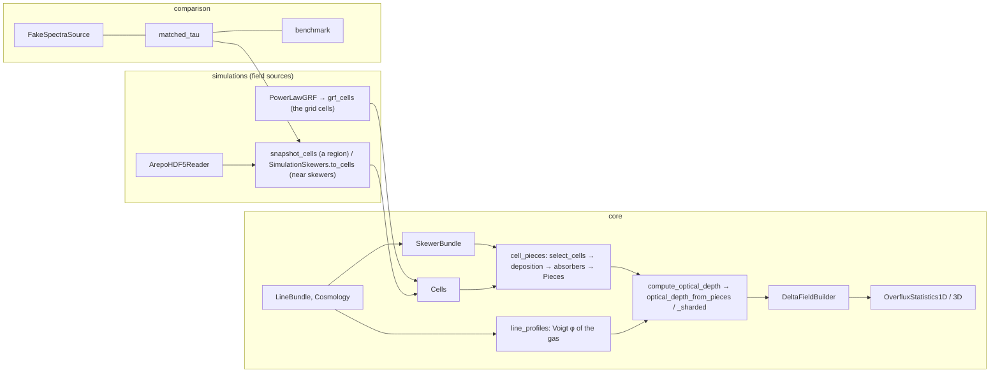

# Usage guide

This guide is the reference companion of the notebooks. It lists the entry points of each subpackage, the conventions they
share and the options that control speed and memory. The notebooks (`notebooks/00_quickstart`, `00_quickstart_step_by_step`, `01`–`09`) show
the same tools at work, step by step.



Dependencies run one way only: `comparison` uses `simulations`, `simulations` uses `core`, and nothing in `core`
imports the other subpackages. `simulations` holds every source of gas cells: the toy fields and the snapshots. `skewerjax.utils.plotting` is outside them.

## Conventions

- **Units.** Comoving Mpc for positions and path lengths, km/s for velocities, K for temperatures. Number densities are
  comoving cm⁻³ in `core.Cells`, `core.Absorbers` and `core.Pieces` (a snapshot's physical n_ion is multiplied by
  a_snap³ in `SimulationSkewers.to_cells`). Wavelengths are in Å.
- **Shapes.** τ is `(N_lines, N_skewers, N_v)`; a `SkewerBundle` holds `(N_cosmologies, N_skewers, N_points, 4)` events
  (a, x, y, z).
- **Cells.** Every source of gas is a set of Voronoi cells, `core.Cells`: generating points, volumes (size V^(1/3)),
  the periodic box and, per species, `number_density`, `temperature`, `velocity` (and optional `turbulence`,
  `collisional`). The field sources of `skewerjax.simulations` fill it: the toy fields (`grf_cells`: the cells of the
  grid, the Voronoi cells of its nodes, i.e. cubes centred on them) and the snapshots after their gas physics (`snapshot_cells`
  for a region of the box, `SimulationSkewers.to_cells` for the cells near a set of skewers).
- **Pieces.** τ is a sum over pieces, fragments of the path inside one cell (and one dual segment), each evaluated at
  its centroid (a, a⁻², the line centre) with its cell's values. `cell_pieces` (selection, deposition, absorbers) builds
  them for every source; they reach the kernel as `core.Pieces` through `compute_optical_depth`.
- **Periodicity** is one option of `compute_optical_depth`, `velocity_period`: `False` (default, the direct sum),
  `True` (each skewer periodic over its own velocity span, set by a at its first and last points) or a period in km/s.
  The detuning is then replaced by its nearest image; only that image is kept. `SimulationSkewers.tau`,
  `optical_depth` and `tau_absorbers` pass it through; nothing else wraps a spectrum.
- **Frames.**
  - Each line is integrated in its own line-centred velocity frame v_† (`line_frame="own"`, default), or directly on
    the reference line's axis (`line_frame="reference"`: line j at v + Δv_j).
  - `wrap_to_ref_line` shifts spectra computed in their own frames onto the reference axis by interpolation: without a
    period, τ is NaN where the shift leaves the grid; with `velocity_period=P` (a spectrum computed periodic on a grid of
    one period), it wraps modulo P.
  - In simulations, `frame="exact"` uses a(x) along the path and `frame="snapshot"` uses fake_spectra's single
    redshift with a linear Hubble flow.
- **Precision.** SkewerJAX follows `jax_enable_x64` and never sets it. Every validated tolerance is a float64 one.
- **Purity.** Every container is a JAX pytree, and every kernel of the τ sum can be traced with `jit`, `vmap` and
  `grad`. The host-side parts are NumPy: snapshot I/O, the k-d tree selection, the deposition bookkeeping (so
  `cell_pieces` runs outside `jit`) and fake_spectra.

## `skewerjax.core`

| task | entry point | main options |
|---|---|---|
| lines | `LineBundle(["HI-LyA", "SiIII-1206"], ref_line_id=...)` | any id of `core/lines_table.dat` (`LINES`) |
| background | `Cosmology(H0, Omega_r_0, Omega_m_0, Omega_k_0, Omega_lambda_0)` | batches of cosmologies; `solve_a_of_x(rtol, atol)` |
| skewers | `SkewerBundle(spatial_points, cosmologies, a0, x0, ...)` | `ICs_defined_at_index`, `ICs_at_emission_or_absorption`, `manual_scale_factors` |
| gas cells | `Cells(positions, volumes, species, box)`, `cells_from_values`, `cells_on_grid`, `grid_points`, `voronoi_volumes` | (filled by the sources of `skewerjax.simulations`) |
| line profiles | `core.line_profiles`: `line_profiles(v, lines, temperature=..., los_velocity=..., scale_factor=..., a_dagger=...)`, `voigt_line_profiles`, `voigt_widths_GHz`, `voigt_width_kms` | `voigt` (`"ExoJAX"`, `"convolution"`, `"harris"`: first order in the damping parameter, a ≤ 10⁻³, exact above), `detuning` (`"exact"`, `"linear"`), `velocity_period` |
| τ | `compute_optical_depth(bundle, v, lines, cells, a_dagger=...)` or `compute_optical_depth(pieces, v, lines)` | `deposition` (`"voronoi"` default, `"tophat"`, `"voronoi_crossings"`), `line_frame`, `velocity_period`, `voigt`, `detuning`, `resolution_tolerance`, `v_chunk`, `piece_chunk`, `batch_size`, `per_piece`, `dtype`, `devices` |
| τ (layers) | `select_cells` → `voronoi_segments` / `grid_segments` / `tophat_segments` → `absorbers_from_components` → `absorber_pieces` (all in `cell_pieces`) → `Pieces` → `optical_depth_from_pieces` → `optical_depth_kernel` | `resolution_report(pieces, lines)`; `voronoi_segments(..., backend="jax")`; `tau_absorbers`, `tau_by_path_bins` |
| frames | `compute_optical_depth(..., line_frame="reference")`, `wrap_to_ref_line`, `velocities_in_line_frames`, `line_wavelength_grid_A` | |
| overflux | `DeltaFieldBuilder(tau, labels=...).build()` | every line subset and the exact decomposition of the total |
| statistics | `OverfluxStatistics1D(ov, dv).compute_p1d().compute_xi1d()`, `OverfluxStatistics3D` | pairs, orders, binning (`bin_p1d`, `bin_p3d_kperp`) |
| metal models | `fit_mcdonald_a`, `fit_ma_model_profiled` | |

## `skewerjax.simulations`

**Toy fields.**

| task | entry point | main options |
|---|---|---|
| Gaussian random field | `PowerLawGRF(A_s, k_0, n_s, L=..., N=...)` (or `k_min`, `k_max`, `N_k`); `sample(key)`, `power(k, mu)`, `power_at(*k_components)`, `power_monopole(k)`, `variance()` | optional, off by default: `beta` (Kaiser (1 + beta mu^2)^2), `sigma_fog`, `fog` (`"lorentzian"`, `"gaussian"`), `A_bao`, `r_bao`, `sigma_bao` (a Gaussian bump in xi, exact transform in 1D/2D/3D); `los_axis` (default: the last axis); P >= 0 is checked at construction |
| toy gas cells | `grf_cells(delta, grf, n_bar, ...)` | the cells of the grid (cubes centred on the nodes); `temperature` / `velocity` (and `turbulence`, `collisional`) as scalars, arrays on the grid or functions of the nodes |

**Snapshots.**

```python
from skewerjax.core import LineBundle
from skewerjax.simulations import ArepoHDF5Reader, SimulationSkewers, ExtractionOptions, IntegrationOptions, HI

reader = ArepoHDF5Reader("/home/STORAGE/TNG50-4", 25)
sk = SimulationSkewers.axis_aligned(reader, [[17500.25, 17500.75, 0.0]], [3], spacing_kms=0.25)  # cofm in ckpc/h, axis z
v, tau = sk.optical_depth(LineBundle(["HI-LyA", "SiIII-1206"], ref_line_id="HI-LyA"))           # (2, 1, N_v)
```

- **Skewers:** `SimulationSkewers.axis_aligned` (straight, along a box axis) or `SimulationSkewers.from_bundle` (any
  `SkewerBundle`, with its own a(x)). The constructor selects the cells near the paths, streaming the snapshot in
  blocks of `max_rows` cells. Host memory is therefore set by the block size, not by the snapshot size.
- **Physics options** (`ExtractionOptions`): `deposition` (`"voronoi"` default, `"tophat"`, or the opt-in
  `"voronoi_crossings"`: one absorber per sub-piece of each cell crossing, split so that its velocity width stays below
  0.25 b), `mass_unit`, `T_constants`, `b_constants`, `x_HI_model`, `cloudy_density`, `cloudy_interpolation`.
- **Selection back ends:** `selection.select_cells_near_paths(..., backend="cpu" | "jztree" | "auto")` and
  `SimulationSkewers(..., selection_backend=...)`: `"cpu"` (default, SciPy's periodic `cKDTree`); `"jztree"` (CUDA GPU,
  needs the optional package jztree; borderline cells re-checked in float64 so the set is the CPU one); `"auto"` (the
  GPU when jztree and a CUDA device are present, else the CPU).
- **Cells without skewers:** `snapshot_cells(reader, species, lo, hi, margin=...)` gives the cells of a periodic
  sub-box as `core.Cells` (`select_cells_in_region`, then `gas_to_cells`); the margin keeps every cell whose generating
  point can be the nearest to a point of the region. Cost on TNG50-4: one pass over the positions (about 1 s with a
  warm file cache) plus the gas physics of the kept cells.
- **Cells near skewers:** `sk.to_cells(species)` gives the selected cells as `core.Cells` (per ion: n_ion a_snap³, T,
  the peculiar velocity), the container of the toy fields, with the values of `snapshot_cells` for the same cells. The deposition is the core's (`core.deposition`; `voronoi_segments(...,
  backend="jax")` computes the same pieces in JAX). `SimulationSkewers.crossings()` keeps the cell crossings of the
  skewers alongside their points (`CellCrossings`).
- **Integration options** (`IntegrationOptions`): `frame`, `normalisation`, `detuning`, `dtype`. Periodicity is not one
  of them: `sk.tau(..., velocity_period=...)` and `sk.optical_depth(..., velocity_period=..., line_frame=...)` pass the
  core's option through (default: none). `spectral_grid(res, frame)` spans the velocity span of the box and implies no
  wrap.
- **Lower layers:** `sk.absorbers(ion)` gives the deposited pieces (`core.Absorbers`), `sk.pieces(ion, lines)` the same
  as `core.Pieces` (through `core.cell_pieces`, for `compute_optical_depth`), `core.tau_absorbers(A, lines, v, frame)`
  the τ (options `velocity_period`, `chunk`, `v_chunk`, `dtype`, `devices`, `skewers`), and `sk.tau(...)` the τ cached
  in an HDF5 file when the object has a `name` and a `cache`. Cells already in memory (a region from `snapshot_cells`,
  a toy model) are selected with `core.select_cells`, the same rule as the streamed `select_cells_near_paths`.
- **Figure tools:**
  - `slab_projection(reader, normal_axis, centre, thickness, n_pix)` gives the gas surface density and the
    mass-weighted temperature of a slab;
  - `core.tau_by_path_bins(A, lines, v, frame, s_edges)` gives the τ made by each stretch of the path
    (`00_quickstart_step_by_step`).

## `skewerjax.comparison`

- **Modes:** `FAKE_SPECTRA_EXTRACTION` + `FAKE_SPECTRA_INTEGRATION` reproduce fake_spectra (the matched mode), and
  `ExtractionOptions()` + `DEFAULT_INTEGRATION` are SkewerJAX's defaults. Both use `velocity_period=True`, because
  fake_spectra's spectra are periodic by construction. `matched_tau(sk, ion, lines, v, ext, integ)` evaluates any
  combination.
- **Effect chain:** `run_effects` and `effect_rows` switch one difference at a time (`EXTRACTION_EFFECTS`,
  `INTEGRATION_EFFECTS`).
- **fake_spectra itself:** `FakeSpectraSource(cache=DIR, snap_base=..., snapnum=...)` runs it live, in its own process
  (`python -m skewerjax.comparison.driver full ...`). `FakeSpectraSource(reference=FILE)` reads a file exported earlier
  with `FS.export(FILE)`.
- **Benchmark:** `comparison.benchmark` (`make_config`, `run_suite`, `load_results`, `summary`); see "Benchmarks" below.

## Speed and memory

| knob | where | effect |
|---|---|---|
| `v_chunk` | `compute_optical_depth`, `optical_depth_from_pieces`, `tau_absorbers` (default 4096) | velocities per kernel call: memory ∝ N_lines × N_pieces × v_chunk |
| `batch_size` | `compute_optical_depth`, `optical_depth_from_pieces` | skewers vmapped at once inside `lax.map` (more memory, fewer launches) |
| `piece_chunk` / `chunk` | `compute_optical_depth` / `tau_absorbers` (default 2048) | pieces per kernel call: each skewer's pieces summed in rows (`Pieces.rows`; a static shape) |
| `dtype="float32"` | `compute_optical_depth`, `tau_absorbers`, `IntegrationOptions` | opt-in: 2.4× faster on 16 TNG50-4 skewers on the CPU, max \|ΔF\| 1.6e-3 |
| `devices=` | `compute_optical_depth`, `tau_absorbers`, `optical_depth_sharded` | shards the skewer axis (or a skewer's absorber rows) over devices |
| `max_rows` | `SimulationSkewers` | cells per streamed block of the selection |
| `deposition="voronoi_crossings"` | `ExtractionOptions` | one absorber per (sub-piece of a) cell crossing instead of per piece of every dual segment: ~10× fewer H I absorbers at 0.25 km/s spacing, independent of the spacing |

Sharding uses one call for any number of devices:

```python
import jax
from skewerjax.core import optical_depth_sharded
tau = optical_depth_sharded(pieces, v, lines, devices=jax.devices())    # = optical_depth_from_pieces(...) bit for bit
```

The skewers are padded to a multiple of the device count, and the padding is dropped from the result. On one device the
call falls back to `optical_depth_from_pieces`. To try several devices on one CPU, start Python with
`XLA_FLAGS=--xla_force_host_platform_device_count=N`. This tests the code path only; XLA already uses all the cores of a
single CPU device.

## Validation, tests and benchmarks

```bash
python scripts/validation/run_all.py [--quick] [--skip tng,fake] [--outdir validation_output]
pytest                                                                  # tests/, CPU, seconds per test
python scripts/dev/run_tests.py [test_module ...]                       # the same, without pytest
python scripts/dev/check_markdown_math.py notebooks/*.ipynb             # the notebooks' markdown math (MathJax)
SKEWERJAX_SLOW=1 pytest                                                 # also the TNG50-4 / fake_spectra checks
python scripts/benchmarks/benchmark_vs_fake_spectra.py --sets quick                   # raw results: benchmark_results/raw
python scripts/benchmarks/single_cpu_modes.py --results benchmark_results/single_cpu    # one core, every integration mode
```

The benchmark runs every configuration in its own process with its own CPU set and thread count. It skips the
configurations whose result already exists, and it caps each one at `--cap` seconds. The notebook
`09_fake_spectra_comparison` (Part 2) only reads the results (`RESULTS_DIR`).

## Figures: `skewerjax.utils.plotting`

One call at the top of a notebook or script applies the style of every figure:

```python
from skewerjax.utils.plotting import use_style, use_backend
use_backend()          # interactive figures (ipympl, "%matplotlib widget") in a live notebook; inline when headless
use_style()            # "paper" (default): white background, publication look, Paul Tol's colour-blind-safe "bright" scheme
use_style("dark")      # black background, NeonGlow under every line (the same colours, in the same order)
from skewerjax.utils.plotting import ENTITY_COLORS as EC, PALETTE, CMAPS, FG, BG, DIM, LABELS   # FG, BG, DIM follow the style
```

- Only the background, the foreground (`FG`, `BG`, `DIM`, `ENTITY_COLORS["total"]`) and the direction of the
  sequential maps (`CMAPS["sequential"]`, `"hot"`, `"line"`: low values merge with the background) change between the
  two styles. Import `FG`, `BG` after `use_style`.

- Colours: every discrete colour is Tol's "bright" scheme (`PALETTE` = `tol_colors.colorsets["bright"]`, vendored with
  identical values when `tol_colors` is not installed), in Tol's order (blue, red, green, yellow, cyan, purple, grey).
  `ENTITY_COLORS` fixes the colour of every line and quantity in every notebook (Lyα blue, Si III red, density green,
  temperature purple, velocity yellow, ...). Continuous maps are Tol's (`CMAPS`, registered as `tol_<name>[_r]`).
- Text: minimum font sizes `FONT_MIN` (ticks 16, labels 20, legends / annotations / text boxes 15, floor 13);
  `check_fonts(fig)` lists any text below the floor.
- `SKEWERJAX_HEADLESS=1` forces the inline backend (e.g. when executing notebooks with nbconvert).

- Line styles per mode: `MODE_STYLES`; labels with units: `LABELS`; sizes: `FIGSIZES`.
- `plot_dag(highlight, external=False)`: the dependency graph of the ingredients (`DAG_NODES`, `DAG_EDGES`; every
  edge is a dependency of the code, listed above `DAG_EDGES`).
- Path geometry: `geometry_style(name)`, the one style of points, midpoints, dual segments, tangents, line elements,
  piece ends and generators (03).
- Helpers: `add_panel_letters(axes, labels=None, box=True)` ((a), (b), ... or any labels such as "a1", "a2"),
  `shade_outside_window(ax, v, period, end)` (the part of a velocity axis outside [0, P), with its edge dotted).
- Tutorial figures: `plot_toy_box` (00), `plot_slab_and_skewer`, `plot_cell_crossings`, `plot_voigt_of_piece`,
  `plot_tau_stretches`, `plot_wrap_tiles`, `plot_overflux_p1d_xi` (00b), `plot_grf_draws` (04), `plot_line_table`,
  `plot_scale_factor_solutions`, `plot_skewer_geometry_3d`,
  `plot_isotropic_recovery` (+ `correlation_binned`), `plot_kpar_kperp_maps`, `plot_pk_mu_wedges` (`MU_WEDGES`, + `power_kmu`,
  `field_power_modes`, `input_power_modes`, `binned_power`, `power_map_kpar_kperp`; k_par along `grf.los_axis`, and the
  input of an anisotropic `PowerLawGRF` evaluated at every mode), `plot_nH_T_fractions`, `plot_gas_cells` (the standard
  view of a `core.Cells` along one skewer, `plot_gas_cells(cells, select_cells(cells, bundle.spatial_points), bundle)`:
  the cells it crosses in 3D (cubes, or Voronoi polyhedra), one row per species: density, temperature, peculiar
  velocity with one arrow per cell; 04 and 05),
  `plot_deposition_steps(parts, bundle, regions, v_axes, tau_nowrap, tau_wrap, period=)` (one simulation skewer from
  the parts of `cell_pieces`, its two ends side by side: the cells in 3D, the pieces, every piece's dτ, one profile on
  the circle of `velocity_period` (split at an edge; `track=`, `cut_fraction=`), and τ with and without wrap with Δτ
  split into its sources; 07), `plot_velocity_ring(parts, regions, v, tau_nowrap, tau_wrap, period=)` (the same wrap on
  a ring of circumference P: the no-wrap axis as a spiral, the wrapped one as a ring, both zoomed on the seam, and
  the whole skewer; 07), `plot_voigt_limits`, `plot_frames_axes` (panel (b): each line's own window relabelled at
  v − Δv_j; `tau_scale={line: k}` draws a weak line as exp(−k τ), display only),
  `plot_effect_fluxes`, `plot_skewer_anatomy`, `plot_terms_by_order`,
  `plot_p1d_input_vs_measured` (+ `grf_p1d_along_axis`), `plot_cylinder(..., progress=p)` (one frame per call),
  `plot_slab`, `plot_tau_buildup`, `plot_orders_superimposed`, `plot_pk_recovery`, the benchmark figures `plot_bench_*`.
- `skewerjax.utils.tutorial`: the expected spectra of a GRF along skewers (`p1d_expected`, `p3d_expected_on_skewer_grid`,
  `binned_input_power`).
